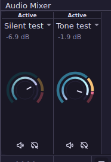
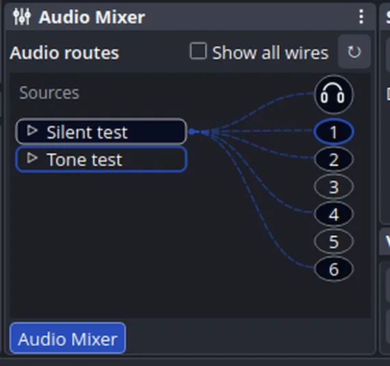
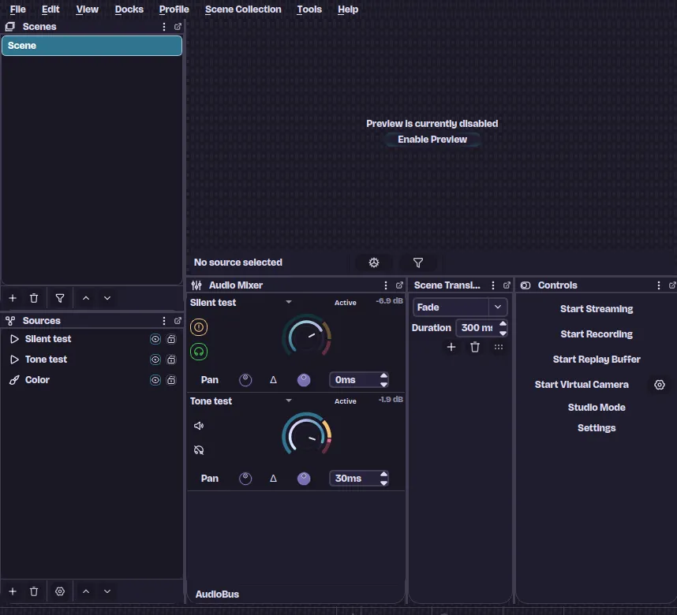
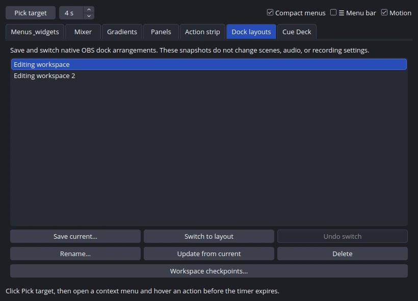
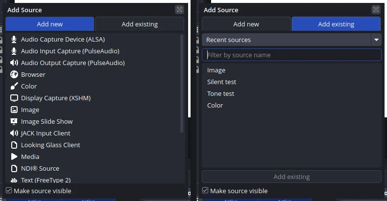
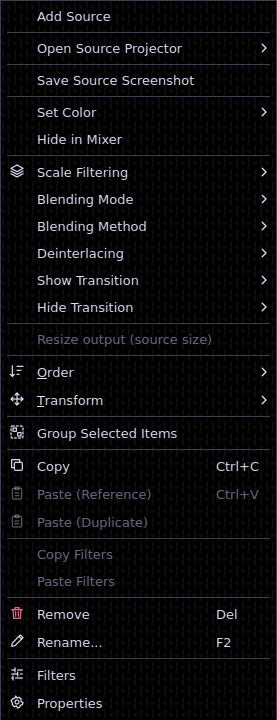
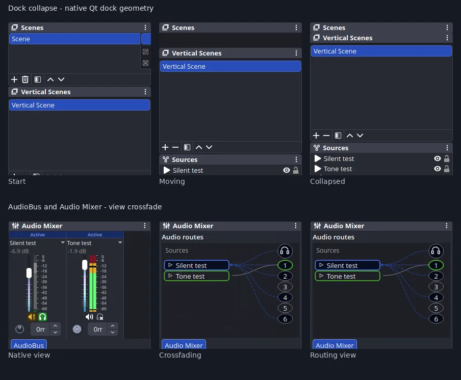
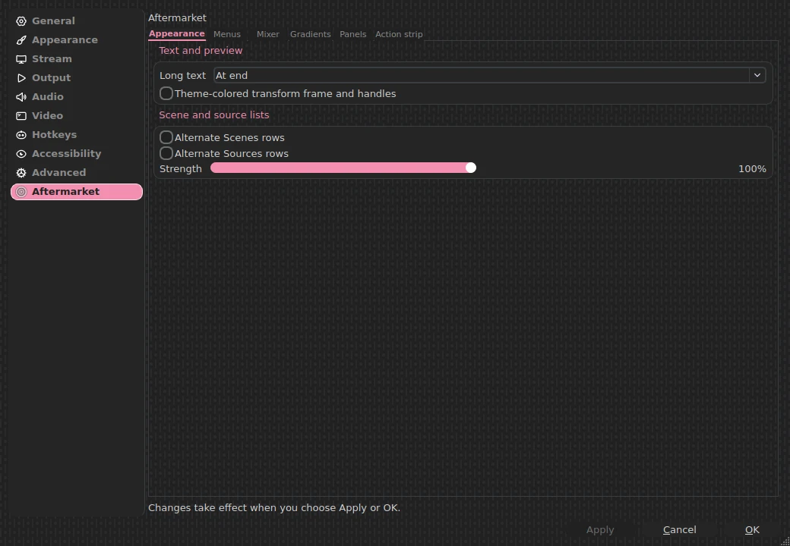

# Aftermarket

**Beyond factory spec.**

A native runtime UI modification engine for OBS Studio. Customize how OBS
looks, moves, and feels without replacing its native controls, forking OBS,
or changing the video compositor. Aftermarket complements Colorway:
the theme supplies the visual identity, and Aftermarket extends interaction,
layout, and presentation.

| Native mixer, reimagined | AudioBus routing |
| :---: | :---: |
|  |  |

[Audio and routing](#audio-and-routing) · [Workspace](#workspace) · [Sources and navigation](#sources-and-navigation) · [Menus](#menus) · [Appearance and motion](#appearance-and-motion) · [Install](#install-locally-linux) · [User guide](docs/user-guide.md)

## Audio and routing

### AudioBus

Turn the Audio Mixer into a two-sided dock. Click **AudioBus** at the bottom
to reveal a patchbay for OBS's native tracks 1–6 and monitoring; click
**Audio Mixer** to return to the original controls.

- Select a source and click a destination to toggle its native route, or drag
  a connection. All wires are shown by default.
- The headphones node controls the source's native monitoring mode.
- Distinct theme-derived outlines show selection and measured audio activity,
  without modifying signal flow.
- The dock's three-dot menu contains routing options, refresh, and the
  original mixer settings.

| AudioBus in the current OBS build | Native monitoring menu |
| :---: | :---: |
|  |  |

### Mixer controls

Keep the familiar native mixer or customize selected channels:

- Rotary gain controls with optional integrated peak rings.
- Per-source audio-reactive gradient faders and native meter color modulation.
- Compact Pan and Sync controls that operate native OBS source properties.
- Channel widths independent of source-name length, with readable labels.


The mixer still belongs to OBS. AudioBus is not a second audio engine,
DSP graph, or hardware output router. [Detailed mixer guide](docs/user-guide.md#mixer-and-audiobus).

## Workspace

### Docks and layouts

Native dock titles get theme-aware icons and compact three-dot menus for
supported collapse, float, and close operations. Roll up a dock without
destroying its contents. Restore the original preview or make it a movable
native dock, including responsive Studio Mode.

Save complete dock arrangements with **Tools → Aftermarket: Dock Layouts…**.
Switch between saved arrangements, or undo the last switch. Layout snapshots
preserve native dock placement, not scene or audio settings.

| Native dock headers | Saved dock arrangements |
| :---: | :---: |
|  |  |

| Compact Studio Mode | Wide floating Studio Mode |
| :---: | :---: |
|  |  |

### Action Strip

Put useful controls in the existing menu bar: OBS and plugin hotkeys,
dock show/hide buttons, live status, saved dock layouts, and Quick Find.
Reorder them directly or use the editor. Extra items move to overflow instead
of being clipped. The optional hamburger menu frees additional space.


[Workspace guide](docs/user-guide.md#workspace-and-dock-controls) ·
[Dock layouts reference](docs/dock-layouts.md)

## Sources and navigation

### Compact Add Source

On compatible OBS 32.2 installations, replace the oversized source chooser's
layout with a compact panel beside Sources.

- **Add new:** click a source type once to create it and open OBS Properties.
- **Add existing:** filter by type and source name, select the result, and use
  OBS's native Add existing action.

Both modes share the native visibility option. OBS retains source identity,
creation, selection, undo, and Properties. The original standalone chooser
remains available in Settings.



### Quick Find

Open **Tools → Aftermarket: Find Sources…** to search the current scene
collection by source, scene, filter, type, file path, or URL. Open native
Properties or Filters, or jump to the scene. Studio Mode navigation targets
the preview rather than the on-air program. Assign an OBS hotkey or add the
palette to the Action Strip for faster access.


[Source and navigation guide](docs/user-guide.md#sources-and-navigation)

## Menus

Long choice menus use balanced compact columns while keeping every native
action available. The ordinary Source context menu stays a familiar single
column. Popups remain on their invocation monitor; nested menus align to
their triggering row, including on offset dual-monitor layouts.

| Native source menu | Augmented source menu |
| :---: | :---: |
|  |  |


Customize specific native menus through the Inspector: add icons, hide
unwanted commands, explicitly move entries into More actions, add trusted
executable commands, and display checked submenu values. The searchable
theme/style picker makes long Appearance lists easier to navigate.

[Menu customization and live rules](docs/user-guide.md#menus-and-rules)

## Appearance and motion

Aftermarket works with the existing OBS theme rather than imposing a new
palette. Optional refinements include:

- Alternating Scenes and Sources row backgrounds with adjustable strength.
- Theme-colored transform selection frames and handles.
- End or middle ellipses for long labels, while preserving actual names.
- Collapsible native property groups.
- Animated gradient tracks, menu artwork, dock collapse, and a brief
  AudioBus half-turn. Disable interface animations for immediate transitions.

| List backgrounds | Transform selection |
| :---: | :---: |
|  |  |



[Appearance and motion guide](docs/user-guide.md#appearance-and-motion)

## Settings and inspector

Open **OBS → Settings → Aftermarket** for normal preferences.
Use the native Apply, OK, and Cancel buttons. The five pages are
Appearance, Menus, Mixer, Panels, and Action strip.



For advanced per-target rules, open **Tools → UI Augment Inspector**.
Capture an actual menu or widget, browse its native identity, and customize
supported targets. Detailed gradient and mixer editors are available there too.

## Install locally (Linux)

Requires matching libobs and OBS frontend API development packages,
Qt 6 Widgets and SVG, CMake, Ninja, and a C++17 compiler. Point CMake to
the development libraries matching your installed OBS.

```sh
cmake -S . -B build -G Ninja -Dlibobs_DIR=/usr/local/lib/cmake/libobs -Dobs-frontend-api_DIR=/usr/local/lib/cmake/obs-frontend-api
cmake --build build
ctest --test-dir build --output-on-failure
./scripts/install.sh
```

Restart OBS. Existing themes and configuration are preserved by the installer.
The installed module and configuration directory retain the original
obs-ui-augment name for compatibility.

**Compatibility:** Runtime verification currently covers Linux/X11,
OBS 32.2.0 and Qt 6.4.2. The native column layout adapter requires the
matching Qt private development headers (qt6-base-private-dev on Debian/Ubuntu)
and runtime; other versions retain compact native rows. Other platforms,
DPI configurations, and OBS versions need additional verification.

## Recovery and documentation

**Ctrl+Alt+Shift+F12** or **Tools → Aftermarket: Emergency restore** restores
native UI presentation without deleting your Aftermarket settings, scenes,
or routing. The safe-mode marker persists across restart. Resume explicitly
when ready.

- [User guide](docs/user-guide.md) — detailed controls, configuration, runtime behavior, and limitations.
- [Dock layouts](docs/dock-layouts.md) — saving, switching, rollback, and compatibility.
- [Verification and development history](ACTIVE_WORK.md) — implementation checkpoints and real runtime evidence.

Screenshots are captured from real, isolated OBS sessions with native themes
and Colorway. The project is independent of OBS Studio and does not replace its
theme system or streaming compositor.
