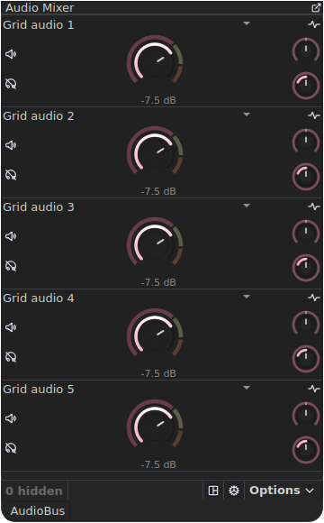
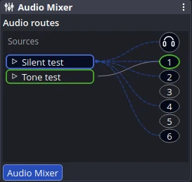
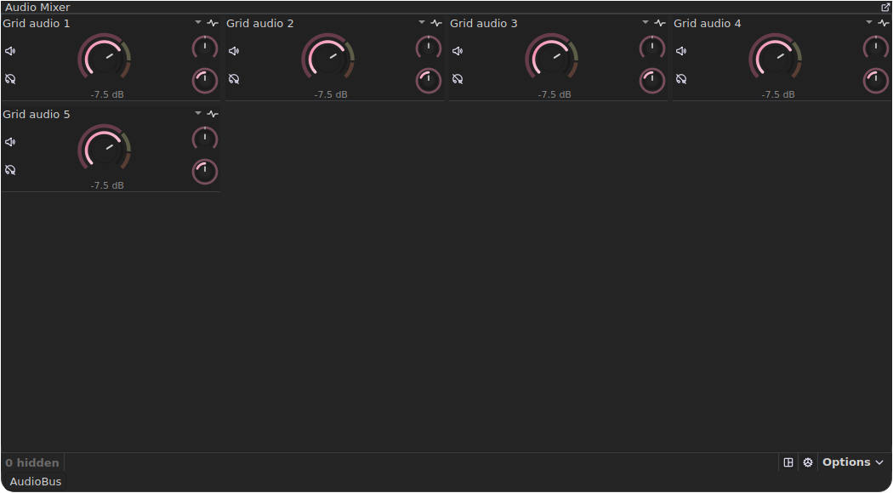
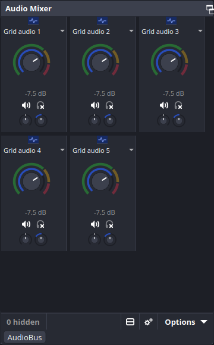
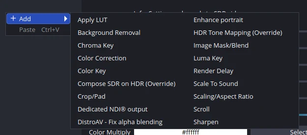
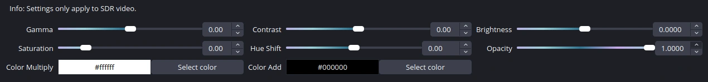

# Aftermarket

**Beyond factory spec.**

A native runtime UI modification engine for OBS Studio. Customize how OBS
looks, moves, and feels without replacing its native controls, forking OBS,
or changing the video compositor. Aftermarket complements Colorway:
the theme supplies the visual identity, and Aftermarket extends interaction,
layout, and presentation.

| Native mixer, reimagined | AudioBus routing |
| :---: | :---: |
|  |  |

[Audio and routing](#audio-and-routing) · [Workspace](#workspace) · [Sources and navigation](#sources-and-navigation) · [Menus](#menus) · [Appearance and motion](#appearance-and-motion) · [Install](#install-locally-linux) · [User guide](docs/user-guide.md)

> **Development preview.** Linux/X11, OBS 32.2.0 and Qt 6.4.2 are the
> locally exercised runtime target. No public binary release is established.
> [Build checks](https://github.com/myrqyry/aftermarket/actions) · [Install locally](#install-locally-linux)

## Audio and routing

### AudioBus

Turn the Audio Mixer into a two-sided dock. Click **AudioBus** at the bottom
to reveal a patchbay for OBS's native tracks 1–6 and monitoring; click
**Audio Mixer** to return to the original controls.

- Select a source and click a destination to toggle its native route, or drag
  a connection. All wires are shown by default.
- The headphones node controls the source's native monitoring mode.
- Distinct theme-derived outlines show selection and measured audio activity,
  without modifying signal flow.
- The dock's three-dot menu contains routing options, refresh, and the
  original mixer settings.

| AudioBus in the current OBS build | Native monitoring menu |
| :---: | :---: |
|  |  |

### Mixer controls

Keep the familiar native mixer or customize selected channels:

- Rotary gain controls with optional integrated peak rings.
- Per-source audio-reactive gradient faders and native meter color modulation.
- Compact Pan and Sync controls that operate native OBS source properties.
- Channel widths independent of source-name length, with readable labels.
- Compact rotary mixer channels in both orientations: native dB value below gain, aligned mute/monitor and pan/sync controls, status icons in the header. Pan and sync share the gain knob’s theme-aware face and accent-ring renderer. Endless relative sync encoder (Shift for fine adjustment); right-click for exact milliseconds.
- Responsive mixer grid: up to four columns for horizontal-fader rows, and automatic wrapping of compact side-by-side rotary strips when all rows fit. Auto mixer grid toggle in the title menu.
- Persistent channel order: unlock in the mixer title menu, drag source names,
  then lock again. AudioBus follows the same saved order; reset restores native order.

| Responsive rotary mixer (wide dock) | Native gradient faders |
| :---: | :---: |
|  |  |



The rotary screenshots use an isolated OBS 32.2.0 test profile with five synthetic audio sources. To adjust sync, drag vertically or scroll (10 ms per pixel or wheel detent), hold Shift for 1 ms, or right-click for exact entry. The indicator turns continuously; the actual offset is clamped, not wrapped.

**Optional independent device sends:** install [Exeldro's Audio Monitor](https://obsproject.com/forum/resources/audio-monitor.1186/) to expose playback devices below the native track nodes. Drag a source to a device; right-click its wire for independent mute, gain, pan and delay. Choose visible destinations from the mixer title menu. Existing Audio Monitor filters are not taken over by Aftermarket. Without the plugin, the native graph works normally.

The mixer still belongs to OBS. AudioBus does not implement a second audio engine or DSP graph; optional device sends use the Audio Monitor plugin's own filters. [Detailed mixer guide](docs/user-guide.md#mixer-and-audiobus).

## Workspace

The main **Tools → Aftermarket → Workspace** window contains seven tabs:
Menus & widgets, Mixer, Gradients, Panels, Action strip, Dock layouts and
Cue Deck. Quick Find, Command Center and Emergency restore are the other Tools
commands. Routine preferences remain in OBS Settings.

### Docks and layouts

Native dock titles get theme-aware icons and compact three-dot menus for
supported collapse, float, and close operations. Roll up a dock without
destroying its contents. Restore the original preview or make it a movable
native dock, including responsive Studio Mode.

When the Colorway theme package provides its plugin-icon registry, Aftermarket
uses the registered source/filter types and exact dock IDs to display the custom
glyphs in its source picker, Source Inspector, Quick Find and dock title bars.
Both ink polarities follow the current palette; unknown IDs and missing
assets retain the original or generic icon. No external plugin is required
or patched, and the stock OBS source tree is not rewritten.

Save complete dock arrangements with **Tools → Aftermarket → Workspace → Dock layouts**.
Switch between saved arrangements, or undo the last switch. Layout snapshots
preserve native dock placement, not scene or audio settings.

**Workspace checkpoints** extend the layout manager with named local recovery bundles:
the freshly saved OBS scene collection, native dock state, and selected Aftermarket settings.
Restore docks independently or export scene/settings files for deliberate recovery.
No live scene collection or settings are overwritten.
If [Scene Collection Manager](https://obsproject.com/forum/resources/scene-collection-manager.1434/)
is loaded, optionally create a verified companion backup in its native backup library and open
its manager directly from Dock Layouts.

Optional [Source Dock](https://obsproject.com/forum/resources/source-dock.1317/) panels
receive the native Aftermarket header controls and a shortcut to Source Docks settings.
Use **Pin to workspace** in Quick Find to create an actual Source Dock without switching scenes.
The optional Source Dock workspace-api fork supplies a native pinning API,
independent SDR preview refresh (Live, 30, 15, 10, 5, 2, 1 FPS or Freeze),
controls-only mode and cached resolution (2048, 1280, 640 or 320 px).
Hidden previews release their cache and showing reference. Stock 0.5.1
supports the guarded pinning adapter but not these new preview options.
The fork retains upstream module identity and license; no public fork
release is established.
Optional [Frame Interleave Filter](https://obsproject.com/forum/resources/frame-interleave-filter.1618/)
adds **Off-air frame limit** to eligible asynchronous video sources in the Quick Find
context menu; the original filter handles activity-aware frame dropping.
Workspace checkpoints capture Source Dock settings and Frame Interleave filters through the native scene collection. Neither integration replaces the underlying source or Program renderer.

| Native dock headers | Saved dock arrangements |
| :---: | :---: |
|  |  |

| Compact Studio Mode | Wide floating Studio Mode |
| :---: | :---: |
|  |  |

### Action Strip

Put useful controls in the existing menu bar: OBS and plugin hotkeys,
dock show/hide buttons, live status, saved dock layouts, Cue Deck sequences, and Quick Find.
Reorder them directly or use the editor. Extra items move to overflow instead
of being clipped. The optional hamburger menu frees additional space.


[Workspace guide](docs/user-guide.md#workspace-and-dock-controls) ·
[Dock layouts reference](docs/dock-layouts.md)

### Cue Deck

Use **Tools → Aftermarket → Workspace → Cue Deck** to create named sequences of saved
dock-layout changes, native OBS or plugin hotkeys, and timed waits. Reorder
steps, run or stop a cue, and optionally pin it to the Action Strip.
Existing plugin hotkeys—including Exeldro Move actions when registered by
OBS—can be used without replacing their effects. Cue Deck checks for missing
actions before running, and runs only when you explicitly invoke a cue. Hotkey
actions themselves can change what's on air.

[See Cue Deck instructions](docs/user-guide.md#cue-deck)

## Sources and navigation

### Compact Add Source

On compatible OBS 32.2 installations, replace the oversized source chooser's
layout with a compact panel beside Sources.

- **Add new:** click a source type once to create it and open OBS Properties.
- **Add existing:** browse compact source thumbnails, filter by type and
  source name, select a result, and use OBS's native Add existing action.

Both modes share the native visibility option. OBS retains source identity,
creation, selection, undo, and Properties. The original standalone chooser
remains available in Settings.


### Command Center and Source Inspector

The centered menu-strip field opens a keyboard-navigable command palette.
Use `@` to find sources, scenes and filters, or `/` for Aftermarket commands
and registered OBS hotkeys. Hotkeys require explicit confirmation. Source
results pin the optional native Source Inspector dock without changing scenes.
Open **Docks → Source Inspector** to follow source selection, see the scene-item
transform, save/load named transform presets, add/search/toggle/reorder/remove
filters and check scene references, or open native Properties and Filters.
Transform loads and filter edits participate in OBS Edit → Undo/Redo. [Command center guide](docs/user-guide.md#command-center-and-source-inspector).

### Quick Find

Click outside either the compact Add Source picker or the Quick Find popup to dismiss it.

Open **Tools → Aftermarket → Find Sources…** to search the current scene
collection by source, scene, filter, type, file path, or URL. Open native
Properties or Filters, or jump to the scene. Studio Mode navigation targets
the preview rather than the on-air program. Assign an OBS hotkey or add the
palette to the Action Strip for faster access.


[Source and navigation guide](docs/user-guide.md#sources-and-navigation)

## Menus

Long choice menus use balanced compact columns while keeping every native
action available. The ordinary Source context menu stays a familiar single
column. Popups remain on their invocation monitor; nested menus align to
their triggering row, including on offset dual-monitor layouts.

| Native source menu | Augmented source menu |
| :---: | :---: |
|  |  |



Native Qt tooltips have a configurable maximum width (360 logical px by default), with automatic wrapping and a native unlimited option.

Customize specific native menus in Workspace → Menus & widgets: add icons, hide
unwanted commands, explicitly move entries into More actions, add trusted
executable commands, and display checked submenu values. The searchable
theme/style picker makes long Appearance lists easier to navigate.

[Menu customization and live rules](docs/user-guide.md#menus-and-rules)

## Appearance and motion

Aftermarket works with the existing OBS theme rather than imposing a new
palette. Optional refinements include:

- Alternating Scenes and Sources row backgrounds with adjustable strength.
- Theme-colored transform selection frames and handles.
- End or middle ellipses for long labels, while preserving actual names.
- Responsive source/filter property columns (Auto, 1, up to 2, or up to 3) and collapsible native property groups.
- Named source/filter property and whole filter-chain presets directly in the native Defaults/OK/Close footer, with portable JSON import/export.
- Gradient tracks and optional native dock titlebar accents: Flow, Reverse, Ping-pong, Breathing, Shimmer and Static, using one shared palette, loop and clock.
- Animated menu artwork (soft, pop, spin, fade and lift), dock collapse, and a snapshot-free AudioBus folding reveal. Aftermarket-owned dock, Studio and Action Strip toggle controls have subtle animated state feedback. Bounded elapsed-time steps, partial repaint regions and idle timers reduce GUI work. Disable Motion for immediate transitions.

| List backgrounds | Transform selection |
| :---: | :---: |
|  |  |



**Property presets:** choose a saved preset, Load, Save a new preset, or use
the overflow menu to update, rename, delete, or undo the last load. Presets
are scoped to the exact source/filter type. In Filters, toggle **Whole filter chain** in the overflow menu to save or replace an ordered chain, including settings and enabled state. Import/export supports both preset scopes. Native Defaults and source
OK/Cancel remain intact. See [property presets](docs/user-guide.md#named-source-and-filter-presets).

[Appearance and motion guide](docs/user-guide.md#appearance-and-motion)

## Settings and Workspace

Open **OBS → Settings → Aftermarket** for normal preferences.
Use the native Apply, OK, and Cancel buttons. The five pages are
Appearance, Menus, Mixer, Panels, and Action strip.


All Aftermarket tools are grouped in a single **Tools → Aftermarket** submenu. For advanced per-target rules, open **Tools → Aftermarket → Workspace**.
Capture an actual menu or widget, browse its native identity, and customize
supported targets. Detailed gradient and mixer editors are available there too.

## Install locally (Linux)

Requires matching libobs and OBS frontend API development packages,
Qt 6 Widgets and SVG, CMake, Ninja, and a C++17 compiler. Point CMake to
the development libraries matching your installed OBS.

```sh
cmake -S . -B build -G Ninja -Dlibobs_DIR=/usr/local/lib/cmake/libobs -Dobs-frontend-api_DIR=/usr/local/lib/cmake/obs-frontend-api
cmake --build build
ctest --test-dir build --output-on-failure
./scripts/install.sh
```

Restart OBS. Existing themes and configuration are preserved by the installer. For same-name upgrades, back up the previous module outside the plugin directory before installing. Optional companion plugins are installed separately.
The module and configuration directory are now named aftermarket. The Linux installer moves the legacy obs-ui-augment package outside OBS’s search path; existing settings migrate as a complete directory on the next launch. See the [upgrade guide](docs/user-guide.md#upgrading-from-obs-ui-augment).

**Compatibility:** Runtime verification currently covers Linux/X11,
OBS 32.2.0 and Qt 6.4.2. The native column layout adapter requires the
matching Qt private development headers (qt6-base-private-dev on Debian/Ubuntu)
and runtime; other versions retain compact native rows. Other platforms,
DPI configurations, and OBS versions need additional verification.

## Build and verification

The [Linux CI workflow](.github/workflows/ci.yml) targets Ubuntu 24.04 and
a SHA-256-pinned OBS 32.2.0 SDK. It checks local README links, builds the
module, runs the native Qt/libobs CTest suite under an isolated X display
(CI baseline: at least 32 tests, no skips; current local suite: 39), stages the plugin, checks linked libraries
and the exact package contents, and verifies the archive checksum.
It does not install into a user's profile, publish release assets, or
claim Windows, macOS, or OBS 33 support.

| Target | Verification boundary |
| --- | --- |
| Linux x86_64 / OBS 32.2 / Qt 6.4.2 | Local native tests and isolated OBS GUI exercises |
| Ubuntu 24.04 / pinned OBS 32.2 SDK | Local CI driver passed; hosted result pending |
| Windows, macOS, OBS 31/33 | Not qualified |

For a local build using matching development headers, use the commands
above. The same CI validation driver can also run against an explicit
installed SDK (see [CI guide](docs/ci.md)). The temporary module-only
archive is for verification, not an authorized distributable release.

## Recovery and documentation

**Ctrl+Alt+Shift+F12** or **Tools → Aftermarket → Emergency restore** restores
native UI presentation without deleting your Aftermarket settings, scenes,
or routing. The safe-mode marker persists across restart. Resume explicitly
when ready.

- [User guide](docs/user-guide.md) — detailed controls, configuration, runtime behavior, and limitations.
- [Dock layouts](docs/dock-layouts.md) — saving, switching, rollback, and compatibility.
- [Verification and development history](ACTIVE_WORK.md) — implementation checkpoints and real runtime evidence.

Screenshots are captured from real, isolated OBS sessions with native themes
and Colorway. Workspace, Quick Find and responsive properties images reflect the current interface; other feature screenshots may depict earlier verified builds. The project is independent of OBS Studio and does not replace its
theme system or streaming compositor.
