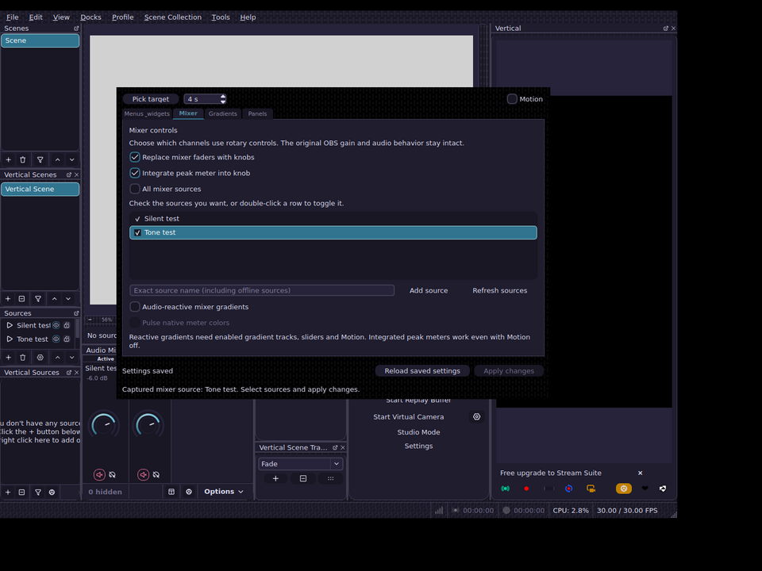
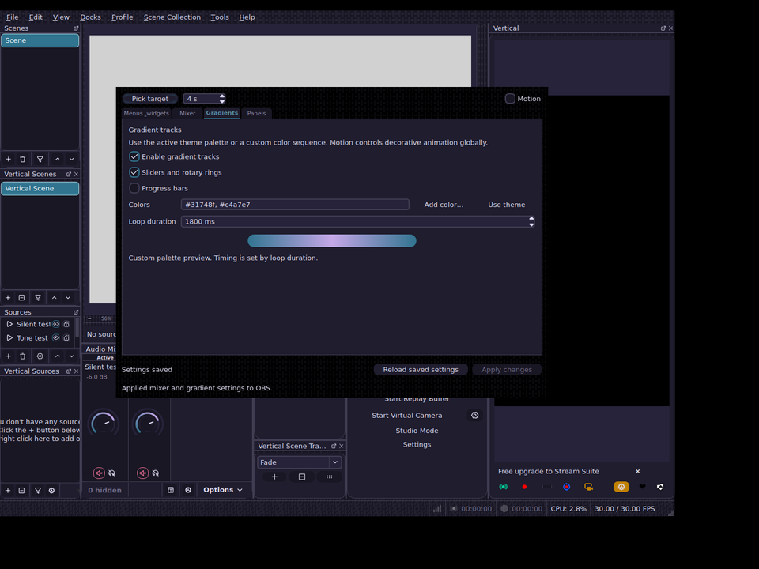
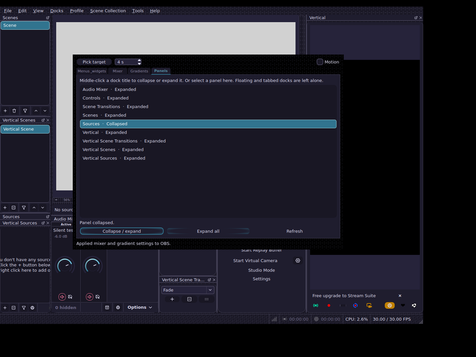
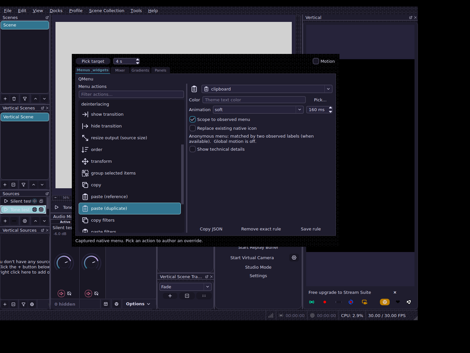
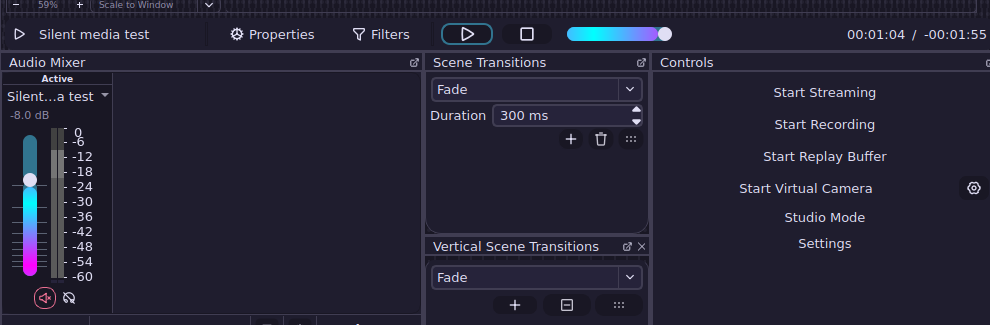
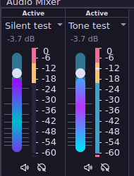
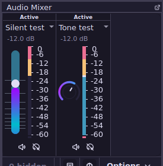
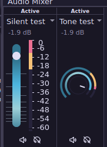
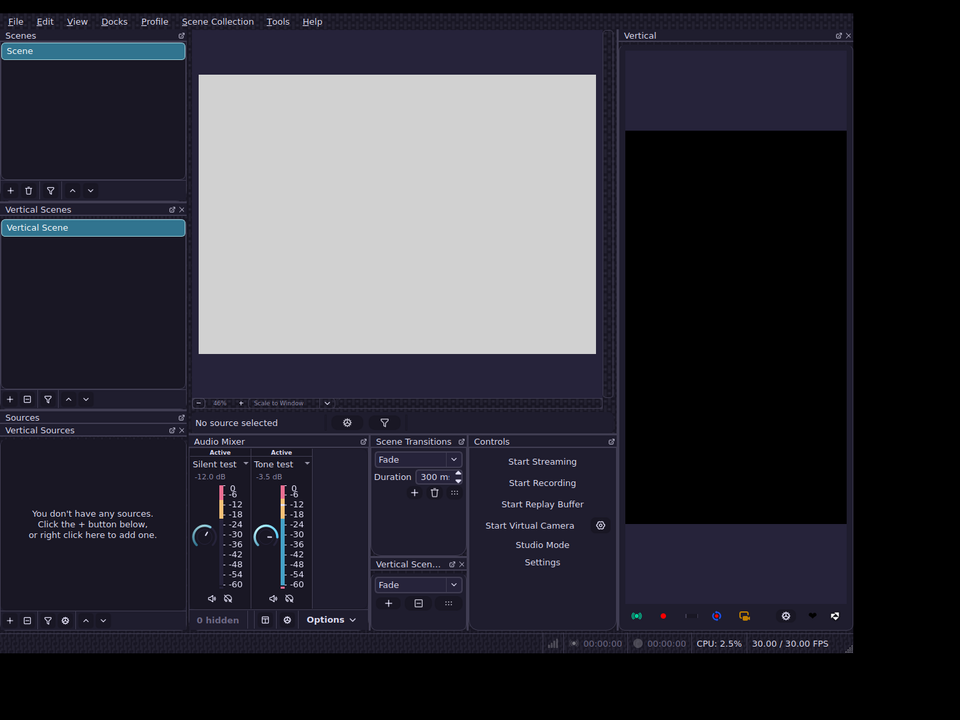

# OBS UI Augment

An experimental runtime augmentation layer for OBS Studio. The first slice adds independently painted icons to the existing menus without changing OBS themes or source objects.

| Native | Augmented |
| --- | --- |
|  |  |

Real OBS 32.2.0, Qt 6.4.2, Colorway Rosé Pine — Pine, isolated X11 test profile.

## Install locally (Linux)

Requires the matching libobs and OBS frontend API development packages, Qt 6 Widgets and SVG, CMake and a C++17 compiler. Use the CMake package for the libobs actually loaded by the installed OBS executable.

```sh
cmake -S . -B build -G Ninja -Dlibobs_DIR=/usr/local/lib/cmake/libobs -Dobs-frontend-api_DIR=/usr/local/lib/cmake/obs-frontend-api
cmake --build build
ctest --test-dir build --output-on-failure
./scripts/install.sh
```

Restart OBS (or open it if closed). The module creates its rules file at
`~/.config/obs-studio/plugin_config/obs-ui-augment/rules.json` by default.
If XDG_CONFIG_HOME is set, use that configuration root.

## Inspector workspace

Open **Tools → UI Augment Inspector**. All existing effects are now accessible
from four pages in one native, theme-aware window:

- **Menus & widgets:** Pick target with an adjustable 2–10 second delay,
  open a context menu and hover an action. Filter captured labels, see saved
  icon previews, choose an icon/color/animation and save a rule. Technical
  geometry, ancestry and generated JSON are available through Show technical
  details; ordinary widget capture remains read-only.
- **Mixer:** choose all current/future mixer sources or check individual
  live source names. Refresh the actual mixer list or add an exact offline
  name, including names containing semicolons. Select knobs, integrated
  peak meters, per-source reactive gradients or native meter color pulses.
  Picking a mixer widget opens this page at its source, without changing it.
- **Gradients:** enable track categories, select theme palette or enter
  custom colors, add colors with the native color picker, preview the
  sequence and adjust loop duration.
- **Panels:** collapse/expand eligible native docks, refresh the list or
  expand all. The legacy Tools → UI Augment Panels shortcut opens this page.







Mixer and gradient edits share an explicit Apply changes button; a pending
indicator and Reload saved settings distinguish the draft from applied
settings. No separate editor dialog is needed. Apply preserves unknown
settings and rejects conflicting external changes rather than overwriting
them; an empty individual selection never silently selects all sources.
Motion remains a global immediate toggle. Menu rules still save individually.

Scope a menu rule to its captured menu (default), or uncheck scope to target
the action across menus. Reopen the menu after saving. Existing native icons
require explicit replacement. Remove exact rule deletes only the identical
selector and leaves broader rules intact. The menu matcher's previous
heuristic and rule precedence are unchanged.



## Motion

Open **Tools → UI Augment Inspector** and enable **Motion** in the toolbar.
This applies the default soft effect to matched icons the next time a menu opens.
Motion is off by default, so existing configurations retain their static appearance.
For individual actions, pick a preset and duration in the inspector and save the rule.

- **soft**: fade/slide entrance, modest icon growth on hover.
- **pop**: fade/slide with a more pronounced scale transition.
- **spin**: fade/slide with rotation on hover.
- **none**: static icon even when global motion is enabled.

The duration is 60–600 ms (default 160 ms); a capped 9 ms stagger separates successive entrances.
Uncheck Motion for reduced motion. The master switch persists in the rules file; it is applied when a menu opens.

```json
{
  "enabled": true,
  "motion": true,
  "rules": [
    {
      "text": "Filters",
      "icon": "sliders",
      "animation": {"preset": "spin", "duration": 220}
    }
  ]
}
```

The native menu and its hit targets never move. Only the independently drawn icon layer
changes. The renderer caches rasterized SVGs at the display's device pixel ratio, clips
motion to the icon gutter, uses monotonic elapsed time with cubic easing, and stops its
16 ms timer when transitions finish or the menu closes. Hover retargets from its current
value rather than snapping to an endpoint.


Verified in isolated OBS 32.2.0 with the actual Colorway Rosé Pine theme: GUI enabled
motion, selected spin and a 600 ms duration for Scale Filtering, persisted the scoped
rule, and captured changing icon pixels during both entrance and hover.

## Animated gradient tracks

Open **Tools → UI Augment Inspector → Gradients**. Turn on **Enable gradient tracks**, select sliders and/or progress bars, and apply. Enable the inspector's global **Motion** toggle for flowing gradients. The defaults leave existing configurations untouched.

- Sliders and media seek bars: gradient follows native slider position, including vertical faders, inverted appearance and right-to-left geometry. The native thumb and input stay intact.
- Determinate progress bars: fill follows the widget's actual range and value; text-bearing bars use a thin accent strip to preserve native text. Indeterminate, empty, hidden and disabled tracks are not painted.
- Colors: leave blank for the native palette, or specify 2–6 opaque colors separated by commas. Loop duration is adjustable from 400–12000 ms.

```json
{
  "enabled": true,
  "motion": true,
  "gradient": {
    "enabled": true,
    "sliders": true,
    "progress": true,
    "period": 1800,
    "colors": ["#31748f", "#c4a7e7", "#9ccfd8"]
  },
  "rules": []
}
```

Edit just the gradient and motion fields in an existing file to preserve your menu rules. The inspector merges settings into the existing file, atomically. Changes apply without a theme reload or restart; the rules watcher also reloads valid external edits. Motion off freezes the gradient; gradient off removes the decoration entirely.

The overlay derives groove, thumb and progress content rectangles from Qt's actual style geometry. It uses a seamless repeated gradient and one shared 30 Hz timer, which stops if there are no visible, nonempty animated tracks. It never writes slider values or changes the stream compositor.



Verified in an isolated OBS 32.2.0 session with Colorway Rosé Pine, native media playback and mixer fader. Both tracks' pixels changed while paused elapsed text stayed fixed; native seeking updated playback position. Live motion-disable made the pixels stable, and live gradient-disable restored the native appearance. Qt regression tests cover progress bars, vertical and inverted sliders, stylesheet geometry, invalid configuration and reduced motion. Progress bars were tested in Qt, not a specific OBS progress dialog. Custom-drawn controls that are not QSlider/QProgressBar are outside this slice.

## Audio-reactive mixer effects

In **Tools → UI Augment Inspector**, enable gradient tracks on Gradients, then open Mixer and enable
**Audio-reactive mixer gradients**, and optionally **Pulse native meter colors**.
Enable Motion in the inspector. The effects are opt-in and can be toggled live.

- Each mixer fader follows its own source's libobs magnitude, not the global
  clock or another channel. Audio energy accelerates gradient flow and raises
  brightness; silence or mute brings the effect to rest. The native slider
  position and volume never change.
- The native meter's nominal foreground color responds to the same envelope
  by brightening its current theme color. This is a color modulation, not a
  replacement meter renderer. Warning, clipping, disabled colors, magnitude
  and peak-hold geometry remain under OBS control.
- Non-mixer sliders and progress bars retain the time-driven gradient behavior.

The exponential envelope uses 55 ms attack and 220 ms release.
Audio callbacks publish only a numeric magnitude and timestamp; no waveforms
are retained and no audio is sent anywhere. Source identity is matched to the
full current VolumeName button label; weak source references are revalidated.
No private OBS object offsets or ABI casts are used. Probes are released after
the associated controls stop requesting levels, or when the effects are disabled.

Add these keys to an existing gradient object:

```json
{
  "audioReactive": true,
  "meters": true
}
```



Verified with real OBS 32.2.0, Colorway Rosé Pine, two isolated media sources
and no active recording or streaming: 1218 changed pixels on the tone fader
versus zero on the silent fader. Turning Motion off restored the native meter
nominal color (325 changed pixels); sampled warning/clip and silent-meter regions
were unchanged. Native mute stopped the tone fader effect after release.
The Qt tests also verify independent envelopes, unchanged slider values, theme
base updates and configuration persistence. This first slice is magnitude-driven,
not beat detection or FFT. OBS named-token resolution and full gradient painting
inside meter bars remain future work.

## Rotary mixer knobs

Open **Tools → UI Augment Inspector → Mixer** and check
**Replace mixer faders with knobs**. Enable All mixer sources to replace every
mixer fader, or select specific sources in the checklist (e.g.
`Mic; Music`). Apply without restarting OBS. For now this is limited to mixer
sliders, not seek bars or arbitrary settings controls.

Click and drag a knob up/right to increase volume, down/left to decrease.
There is no value jump on initial press. The original QSlider stays in the
layout and owns range, tracking, value, slider signals, focus, and existing
keyboard/wheel behavior. Its native paint is suppressed while a mouse-transparent
child draws a rotary ring and pointer. Enough minimum size is requested to
fit the knob, subject to the native maximum and surrounding layout constraints.

Knobs work independently of Enable gradient tracks, using native palette colors.
With Sliders and gradient tracks enabled, the ring uses the same configured
palette, motion and optional per-source audio-reactivity as faders.
Toggle knobs off to restore the native slider and its original size constraints
where those have not been changed by another owner. The current volume is preserved.

```json
{
  "knobs": true,
  "knobSources": ["Mic", "Music"]
}
```

Merge these keys into the existing gradient object. Source names are scoped
exactly, not durable source UUIDs; the text UI uses semicolons as delimiters.



Verified in isolated OBS 32.2.0 with Colorway Rosé Pine: Tone test switched to
a knob, Silent test remained a fader; the reactive ring animated (242 changed
pixels, silent fader zero); native volume moved from -12.0 dB to -3.5 dB after
a drag; disabling knobs restored the slider at -3.5 dB. Qt regressions cover
target selection, slider signals, programmatic updates, native key handling,
invalid config and restoration. Horizontal mixer layouts, live source rename
and theme changes under knob sizing need further real runtime testing.

## Integrated knob meters

Knob-enabled mixer channels now default to a combined rotary control rather
than a knob alongside a tall native meter. The inner ring shows gain, the
outer ring shows actual peak dB from the source's libobs volmeter. Metering
continues even with decorative Motion disabled. Native nominal, warning and
error colors are reused, with -60 to 0 dB scale, -20/-9 dB thresholds, a
one-second peak marker, clip flash and 30 dB/s release.



The native meter is hidden only when paired with the supported knob and
source can be resolved. It is restored if the binding is unavailable or
the effect is disabled. Disable **Integrate peak meter into knob** in
Tools → UI Augment Inspector → Mixer to retain the full native meter.
The corresponding JSON key is `gradient.knobMeters` (default true).
The compact control requests a 68-pixel minimum and 76-pixel maximum height
subject to native constraints. The OBS setting for sample/true peak is used.

This is a combined maximum-channel peak display, not a reproduction of the
full multichannel OBS meter, magnitude and input-peak indicators. Use the
native meter for detailed stereo/monitoring work, particularly when checking
levels against the scale or custom threshold settings. The ring does not
modify source gain; the existing inner gain control continues to operate the
original slider. Real vertical mixer verification: one selected knob
replaced only its paired meter, mute cleared the outer ring without moving
gain, both knobs could be selected, and dragging changed the real dB label
from -1.9 to 0.0 dB. Live disable restored the original meter.
The meter scale remains visible at silence and mute, using dimmed native zone colors. Horizontal and vertical layouts have been exercised in isolated OBS, including switching orientation; theme-driven slider size changes are reconciled. Source renaming/rebuilding remain open.

## Collapsible panels

Middle-click a visible dock's title bar to collapse it to its header. Middle-click
again to expand. Alternatively open **Tools → UI Augment Panels**, select a
panel, and choose **Collapse / expand**. **Expand all** restores all rolled-up
panels. The original dock and its contents stay alive; this does not close the
dock or delete OBS sources.



The controller temporarily hides dock content and constrains the dock height
to the native header, preserving its width. It asks QMainWindow to redistribute
space and restores the original size constraints and requested dimensions
when expanded. Neighboring dock sizes remain subject to Qt layout negotiation;
pixel-perfect restoration is not guaranteed. Native close/float gestures
are untouched. Floating, tabified and vertical-title docks are excluded from
collapse in this slice. Closing or relocating a collapsed dock restores it.
The collapse state is session-only; no separate collapse settings are persisted.
The controller restores on the main window close event or unload. Smooth
height transitions are not implemented yet.

Verified in isolated OBS 32.2.0 using Colorway Rosé Pine: Sources collapsed
to a readable title bar at its original column width and expanded to show
the original source list; panel manager collapsed Scenes and Expand all
restored it. Also verified by Qt dock-layout regression tests.

## Live rules

The file is re-read just before a menu opens. Close and reopen the menu after editing it; there is no OBS restart or theme replacement. Invalid or partially written JSON keeps the last valid rules.

Example of a complete replacement rules file:

```json
{
  "enabled": true,
  "inspect": false,
  "rules": [
    {"text": "Add Source", "icon": "plus", "color": "#90d4a6"},
    {"text": "Filters", "icon": "sliders", "color": "#9cc4f5"},
    {"objectName": "actionRemoveSource", "icon": "trash", "color": "#f08b8b", "replaceExisting": true}
  ]
}
```

- `text`: exact action label, ignoring mnemonic ampersands, trailing ellipses, case, and shortcut suffixes.
- `objectName`: exact Qt action identifier. Prefer it when available; many OBS menu actions are created without one.
- `menuObjectName`: optional exact menu identifier. If both action selectors are provided, both must match. First matching rule wins.
- `menuContains`: optional array of neighboring action labels that must all be visible in the target menu. Used to scope otherwise anonymous popups. Matches normalized labels, not order. This is a contextual heuristic, not a unique persistent menu ID; it may not match after menu layout or language changes.
- `icon`: one of plus, pencil, trash, copy, clipboard, move, order, group, sliders, gear, pointer, monitor, camera, palette, layers, arrow-in, arrow-out, resize.
- `color`: optional literal color; without it the icon uses the menu text palette. Disabled entries are dimmed.
- `replaceExisting`: opt in to covering a pre-existing icon with an invisible slot and our own drawing, then restoring it on close. The stock Remove rule uses this to give destructive actions their own color.
- `inspect`: logs the discovered menu labels and action object names to the ordinary OBS log; turn it off again afterward. `enabled:false` disables painting but inspection can remain enabled.

## Why this isn't another QSS theme

A global, non-consuming event filter discovers QMenus as they are polished or shown.
Before each popup, matched, ordinary actions receive a transparent icon as a temporary
layout reservation. The actual icon artwork is owned by a mouse-transparent child
widget, painted against the menu's real action geometry. It does not become a native
QAction icon. OBS/Qt still control keyboard navigation, shortcuts, selection, submenus,
and action execution.

On close or unload, original icons and visibility are restored if the reservation
still belongs to us. Existing icons are left alone by default. Separators,
checkable actions and QWidgetActions are not decorated. Unknown actions are untouched.
The extension is local to UI rendering, not the OBS video compositor.

The first slice is intentionally declarative JSON, not arbitrary code execution.
It does not implement a complete custom menu renderer, custom icon file imports,
general widget styling, or runtime scripts.

## Verification

- Qt regression test: actual magenta pixels in an offscreen QMenu grab; native icon pixels are transparent; existing and checkable icons preserved; rule hot reload, disabled state, invalid JSON fallback, explicit icon override and restoration, cleanup on unload.
- OBS 32.2.0 isolated Xvfb profile: 22 source context-menu actions augmented, then disabled and re-enabled without restarting OBS. Screenshots above were captured from the actual enabled and disabled popup in the same session.
- Clicked rendered Rename item in the real popup and verified native inline editing. See [native rename receipt](docs/screenshots/native-rename.png).
- Isolated OBS exited via Ctrl+Q. No crash observed. The OBS log reported 3 memory leaks at shutdown; their ownership was not established. No claim of leak-free operation.

Inspector slice verification (same isolated OBS configuration):
- Captured an actual source widget and displayed its ancestry.
- Captured Sources context menu from pointer position, selected Scale Filtering, saved a scoped color override from the GUI, reopened the menu and programmatically counted 12 magenta pixels in the actual popup.
- Removed that exact override from the GUI and confirmed the original broader rule remained.
- Added regression tests for scoped matching, escaped ampersands, snapshot lifetime, preserving unknown root fields and unrelated rules, refusing invalid JSON, duplicate override replacement, real rendered pixels, and GUI rule saves.

Only Linux/X11, this OBS/Qt version and this theme have been tested in real OBS.
Fixed 16-pixel artwork and a six-pixel inset suit the tested menu, but additional themes,
DPI scaling, long scrolling menus, RTL, other platforms and other widgets need validation.

## Disable/remove

Set `"enabled": false` in rules.json and reopen menus. To completely unload,
close OBS and remove just `plugins/obs-ui-augment/bin/64bit/obs-ui-augment.so`
from its user config directory. The rules file can be preserved.
