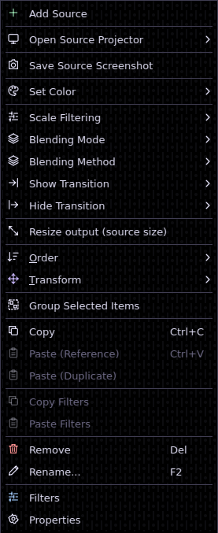
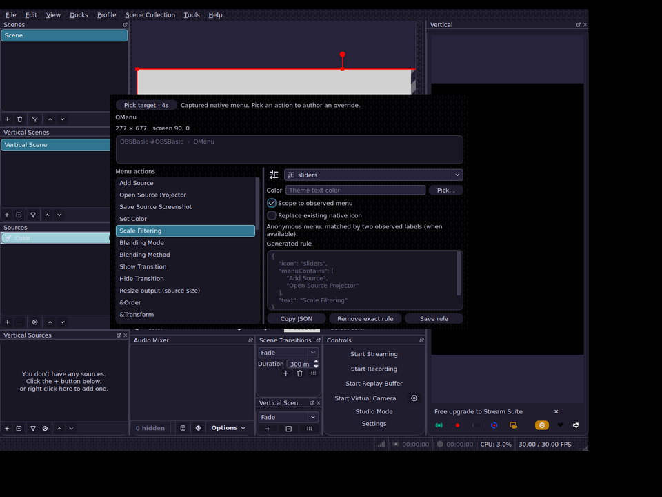
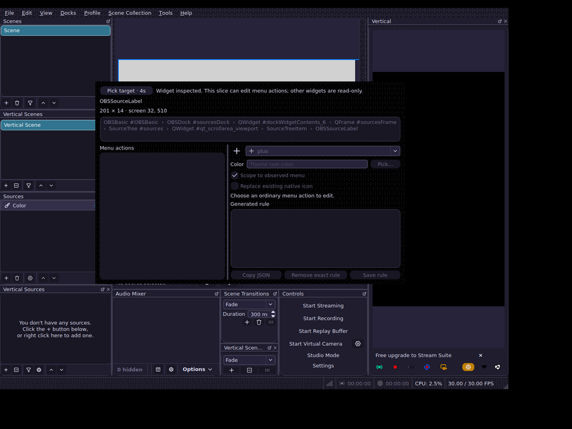
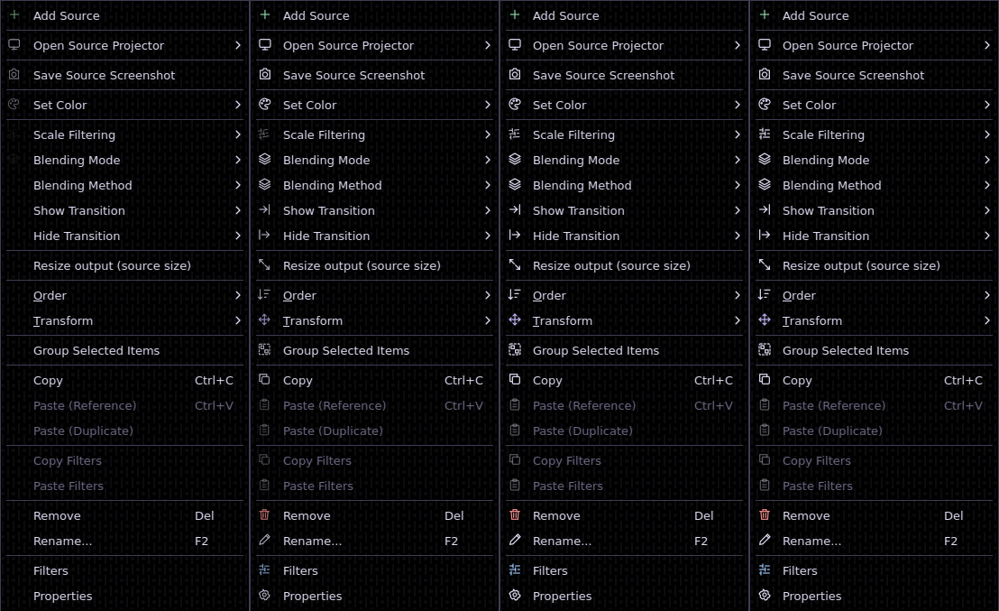

# OBS UI Augment

An experimental runtime augmentation layer for OBS Studio. The first slice adds independently painted icons to the existing menus without changing OBS themes or source objects.

| Native | Augmented |
| --- | --- |
|  |  |

Real OBS 32.2.0, Qt 6.4.2, Colorway Rosé Pine — Pine, isolated X11 test profile.

## Install locally (Linux)

Requires the matching libobs and OBS frontend API development packages, Qt 6 Widgets and SVG, CMake and a C++17 compiler. Use the CMake package for the libobs actually loaded by the installed OBS executable.

```sh
cmake -S . -B build -G Ninja -Dlibobs_DIR=/usr/local/lib/cmake/libobs -Dobs-frontend-api_DIR=/usr/local/lib/cmake/obs-frontend-api
cmake --build build
ctest --test-dir build --output-on-failure
./scripts/install.sh
```

Restart OBS (or open it if closed). The module creates its rules file at
`~/.config/obs-studio/plugin_config/obs-ui-augment/rules.json` by default.
If XDG_CONFIG_HOME is set, use that configuration root.

## Native inspector

Open **Tools → UI Augment Inspector**. Click **Pick target · 4s**; the inspector hides while you move the pointer over an OBS control, or open a context menu and hover an action. After four seconds it snapshots the target and returns.



The left pane lists the captured action labels and Qt object names. Choose an icon and optional color on the right. The generated JSON shows exactly what will match. Scope the rule to the captured menu (default), or uncheck that option to target the action across menus. Save, dismiss the inspector if needed, and reopen the menu. Existing native icons require explicit replacement. Remove exact rule deletes only the identical selector and leaves broader rules intact. Saving prepends the new priority override and replaces rules with the identical selector, without rewriting unrelated rule entries or root fields. Invalid JSON is never overwritten by the inspector.

The inspector also captures arbitrary widget class names, ancestry, accessibility names and geometry, but **editing is currently menu-action only**. For example, the Sources dock's actual label is an OBSSourceLabel under SourceTreeItem.



## Motion

Open **Tools → UI Augment Inspector** and enable **Motion** in the toolbar.
This applies the default soft effect to matched icons the next time a menu opens.
Motion is off by default, so existing configurations retain their static appearance.
For individual actions, pick a preset and duration in the inspector and save the rule.

- **soft**: fade/slide entrance, modest icon growth on hover.
- **pop**: fade/slide with a more pronounced scale transition.
- **spin**: fade/slide with rotation on hover.
- **none**: static icon even when global motion is enabled.

The duration is 60–600 ms (default 160 ms); a capped 9 ms stagger separates successive entrances.
Uncheck Motion for reduced motion. The master switch persists in the rules file; it is applied when a menu opens.

```json
{
  "enabled": true,
  "motion": true,
  "rules": [
    {
      "text": "Filters",
      "icon": "sliders",
      "animation": {"preset": "spin", "duration": 220}
    }
  ]
}
```

The native menu and its hit targets never move. Only the independently drawn icon layer
changes. The renderer caches rasterized SVGs at the display's device pixel ratio, clips
motion to the icon gutter, uses monotonic elapsed time with cubic easing, and stops its
16 ms timer when transitions finish or the menu closes. Hover retargets from its current
value rather than snapping to an endpoint.



Verified in isolated OBS 32.2.0 with the actual Colorway Rosé Pine theme: GUI enabled
motion, selected spin and a 600 ms duration for Scale Filtering, persisted the scoped
rule, and captured changing icon pixels during both entrance and hover.

## Live rules

The file is re-read just before a menu opens. Close and reopen the menu after editing it; there is no OBS restart or theme replacement. Invalid or partially written JSON keeps the last valid rules.

Example of a complete replacement rules file:

```json
{
  "enabled": true,
  "inspect": false,
  "rules": [
    {"text": "Add Source", "icon": "plus", "color": "#90d4a6"},
    {"text": "Filters", "icon": "sliders", "color": "#9cc4f5"},
    {"objectName": "actionRemoveSource", "icon": "trash", "color": "#f08b8b", "replaceExisting": true}
  ]
}
```

- `text`: exact action label, ignoring mnemonic ampersands, trailing ellipses, case, and shortcut suffixes.
- `objectName`: exact Qt action identifier. Prefer it when available; many OBS menu actions are created without one.
- `menuObjectName`: optional exact menu identifier. If both action selectors are provided, both must match. First matching rule wins.
- `menuContains`: optional array of neighboring action labels that must all be visible in the target menu. Used to scope otherwise anonymous popups. Matches normalized labels, not order. This is a contextual heuristic, not a unique persistent menu ID; it may not match after menu layout or language changes.
- `icon`: one of plus, pencil, trash, copy, clipboard, move, order, group, sliders, gear, pointer, monitor, camera, palette, layers, arrow-in, arrow-out, resize.
- `color`: optional literal color; without it the icon uses the menu text palette. Disabled entries are dimmed.
- `replaceExisting`: opt in to covering a pre-existing icon with an invisible slot and our own drawing, then restoring it on close. The stock Remove rule uses this to give destructive actions their own color.
- `inspect`: logs the discovered menu labels and action object names to the ordinary OBS log; turn it off again afterward. `enabled:false` disables painting but inspection can remain enabled.

## Why this isn't another QSS theme

A global, non-consuming event filter discovers QMenus as they are polished or shown.
Before each popup, matched, ordinary actions receive a transparent icon as a temporary
layout reservation. The actual icon artwork is owned by a mouse-transparent child
widget, painted against the menu's real action geometry. It does not become a native
QAction icon. OBS/Qt still control keyboard navigation, shortcuts, selection, submenus,
and action execution.

On close or unload, original icons and visibility are restored if the reservation
still belongs to us. Existing icons are left alone by default. Separators,
checkable actions and QWidgetActions are not decorated. Unknown actions are untouched.
The extension is local to UI rendering, not the OBS video compositor.

The first slice is intentionally declarative JSON, not arbitrary code execution.
It does not implement a complete custom menu renderer, custom icon file imports,
general widget styling, or runtime scripts.

## Verification

- Qt regression test: actual magenta pixels in an offscreen QMenu grab; native icon pixels are transparent; existing and checkable icons preserved; rule hot reload, disabled state, invalid JSON fallback, explicit icon override and restoration, cleanup on unload.
- OBS 32.2.0 isolated Xvfb profile: 22 source context-menu actions augmented, then disabled and re-enabled without restarting OBS. Screenshots above were captured from the actual enabled and disabled popup in the same session.
- Clicked rendered Rename item in the real popup and verified native inline editing. See [native rename receipt](docs/screenshots/native-rename.png).
- Isolated OBS exited via Ctrl+Q. No crash observed. The OBS log reported 3 memory leaks at shutdown; their ownership was not established. No claim of leak-free operation.

Inspector slice verification (same isolated OBS configuration):
- Captured an actual source widget and displayed its ancestry.
- Captured Sources context menu from pointer position, selected Scale Filtering, saved a scoped color override from the GUI, reopened the menu and programmatically counted 12 magenta pixels in the actual popup.
- Removed that exact override from the GUI and confirmed the original broader rule remained.
- Added regression tests for scoped matching, escaped ampersands, snapshot lifetime, preserving unknown root fields and unrelated rules, refusing invalid JSON, duplicate override replacement, real rendered pixels, and GUI rule saves.

Only Linux/X11, this OBS/Qt version and this theme have been tested in real OBS.
Fixed 16-pixel artwork and a six-pixel inset suit the tested menu, but additional themes,
DPI scaling, long scrolling menus, RTL, other platforms and other widgets need validation.

## Disable/remove

Set `"enabled": false` in rules.json and reopen menus. To completely unload,
close OBS and remove just `plugins/obs-ui-augment/bin/64bit/obs-ui-augment.so`
from its user config directory. The rules file can be preserved.
