# Aftermarket user guide

[Back to the overview](../README.md) · [Dock layouts reference](dock-layouts.md)

Detailed workflows, configuration, compatibility, and implementation notes for the native OBS interface extensions.

[Setup](#setup-and-configuration) · [Workspace](#workspace-and-dock-controls) · [Sources](#sources-and-navigation) · [Mixer and AudioBus](#mixer-and-audiobus) · [Menus and rules](#menus-and-rules) · [Appearance](#appearance-and-motion) · [Recovery and verification](#safety-and-implementation)

## Setup and configuration

### Install locally (Linux)

Requires the matching libobs and OBS frontend API development packages, Qt 6 Widgets and SVG, CMake and a C++17 compiler. Use the CMake package for the libobs actually loaded by the installed OBS executable.

```sh
cmake -S . -B build -G Ninja -Dlibobs_DIR=/usr/local/lib/cmake/libobs -Dobs-frontend-api_DIR=/usr/local/lib/cmake/obs-frontend-api
cmake --build build
ctest --test-dir build --output-on-failure
./scripts/install.sh
```

Restart OBS (or open it if closed). The module creates its rules file at
`~/.config/obs-studio/plugin_config/aftermarket/rules.json` by default.
If XDG_CONFIG_HOME is set, use that configuration root.

### Upgrading from obs-ui-augment

Close OBS before launching the new version. The Linux installer preserves the
previous plugin under the user data directory's aftermarket/rollback folder,
outside the active plugin search path. When the renamed module first loads,
it moves the complete legacy configuration directory to plugin_config/aftermarket,
preserving all files including safe-mode.flag. If both directories contain data,
the plugin refuses to start rather than overwrite either one. Back up and resolve
the conflict manually. For a manual package upgrade, remove the old plugin
from OBS's search path before installing the new module.

For rollback, close OBS, remove the new module from the search path, restore
the previous package from the rollback directory, and move the current config
directory back to obs-ui-augment (do not overwrite an existing directory).

### Settings inside OBS

Open **OBS → Settings → Aftermarket** from OBS's normal Settings dialog.
Aftermarket has its own **native Settings sidebar entry** after Advanced,
not an extra dock menu, a Tools-menu shortcut, or another floating Settings
window. It groups interface preferences into **Appearance, Menus, Mixer,
Panels, and Action strip**. The app-wide **Long text** option lives under
**Appearance → At end / In middle**; it no longer appears in every dock's
three-dot menu.

The options are staged until you click OBS's existing **Apply** or **OK**
button. **Cancel discards unapplied Aftermarket changes**, using the same
native Settings controls as other OBS pages. Source names, mixer routing,
and unrelated OBS settings are preserved. Advanced target-specific tools
remain in the Inspector; the regular preferences now have their own home.

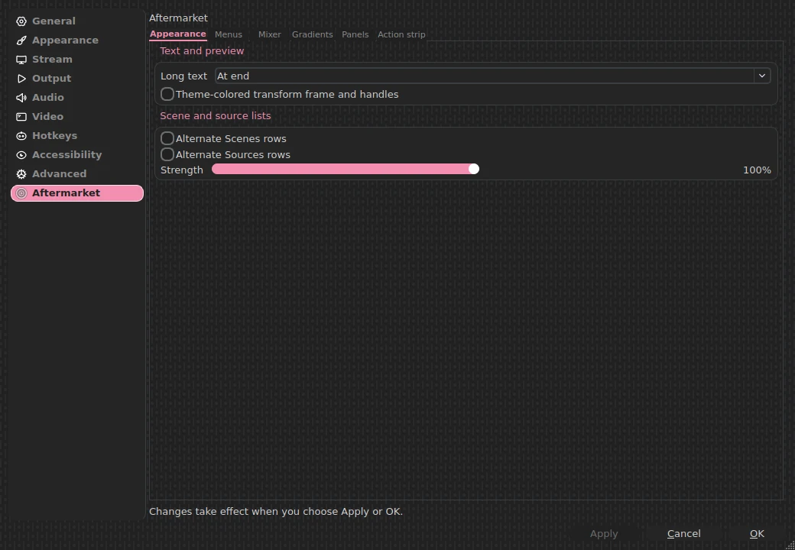

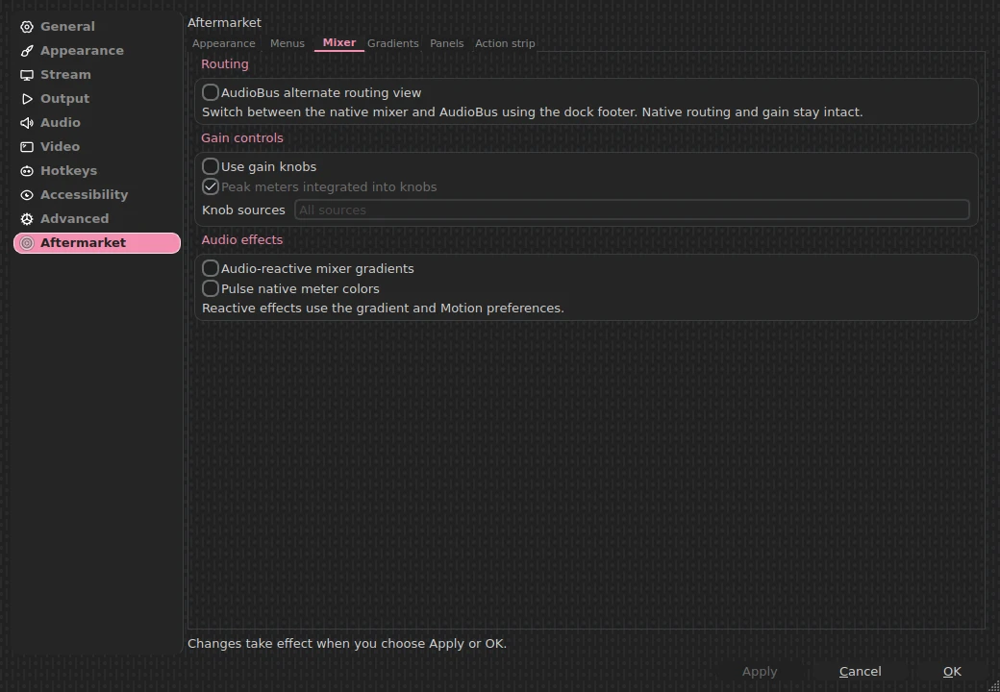

### Inspector workspace

The native Tools menu has one Aftermarket submenu: Workspace, Find Sources, and Emergency restore. The Workspace contains Menus & widgets, Mixer, Gradients, Panels, Action strip, Dock layouts, and Cue Deck tabs. In emergency safe mode only Resume UI customizations is visible. Open **Tools → Aftermarket → Workspace** for advanced per-target editing and
richer visual editors. Its specialized pages remain available for:

- **Menus & widgets:** Pick target with an adjustable 2–10 second delay,
  open a context menu and hover an action. Filter captured labels, see saved
  icon previews, choose an icon/color/animation and save a rule. Technical
  geometry, ancestry and generated JSON are available through Show technical
  details; ordinary widget capture remains read-only.
- **Mixer:** choose all current/future mixer sources or check individual
  live source names. Refresh the actual mixer list or add an exact offline
  name, including names containing semicolons. Select knobs, integrated
  peak meters, per-source reactive gradients or native meter color pulses.
  Picking a mixer widget opens this page at its source, without changing it.
- **Gradients:** enable track categories, select theme palette or enter
  custom colors, add colors with the native color picker, preview the
  sequence and adjust loop duration.
- **Panels:** collapse/expand eligible native docks, refresh the list or
  expand all. Optionally move the existing OBS preview and its source toolbar
  into a movable, floatable, closable native dock, or restore it to the center.
  Enable **Collapsible source / filter property groups** to add independent
  fold arrows to ordinary grouped OBS settings, preserving their live controls.
  Toggle **Audio Mixer backside (native routing)** to add a flip button to
  OBS's real Audio Mixer dock. **Alternating list backgrounds** adds separate
  Scenes and Sources switches with native-theme or custom row colors. The
  The Panels tab of Tools → Aftermarket → Workspace also provides dock controls.

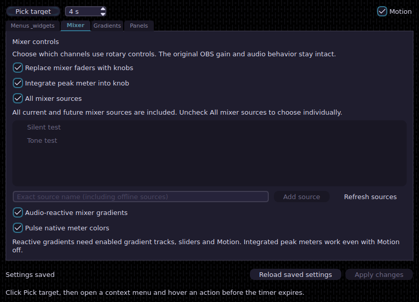

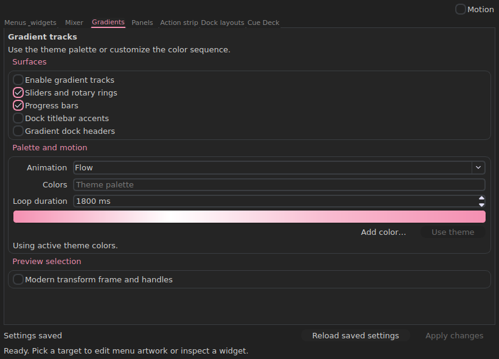

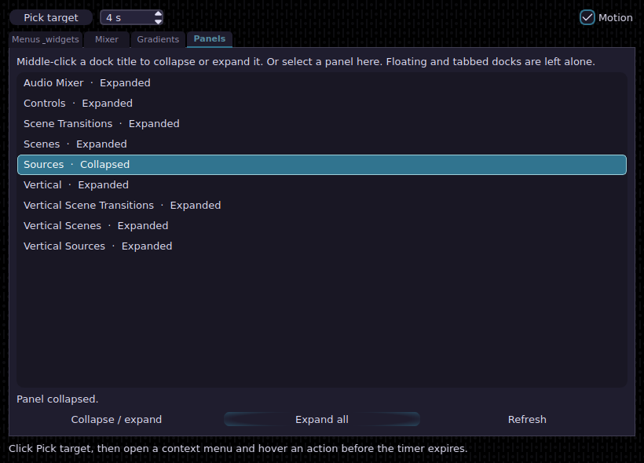

### Responsive source and filter properties

In OBS Settings → Aftermarket → Panels, choose **Source / filter settings**.
Auto (default) uses one column in narrow property panes and up to two or
three when about 680 or 1020 logical pixels of usable width are available.
The 2/3 column preferences are maximums, not forced widths; 1 column
restores the original form. Sliders, spinboxes, checkboxes, combo boxes and
recognized native color picker rows are packed in original row-major order
when their minimum sizes fit. Adjacent compact groups can share a row;
their internal native forms and collapse controls remain intact. File
paths, multiline text, complex controls, and other unrecognized or oversized
rows keep the original full-width layout. OBS's existing widgets and
callbacks are preserved, and replacement property containers reflow after
native property reloads. This applies to source Properties and Filters
dialogs, not every unrelated OBS settings page. Apply/OK saves the preference
as `propertyColumns` (0 = Auto, 1–3 = maximum columns) in rules.json.

Property-group folding is off by default and saved as `collapsiblePropertyGroups` in
`rules.json`. It affects native `OBSPropertiesView` **ordinary QGroupBox sections**
only, not ungrouped filter controls or checkable enable/disable groups. Expanded
content is the original OBS form, and disabling the feature restores its
original row visibility. The folded state is session-only; groups rebuilt by
OBS begin expanded. No settings values are changed by folding.

Mixer and gradient edits share an explicit Apply changes button; a pending
indicator and Reload saved settings distinguish the draft from applied
settings. No separate editor dialog is needed. Apply preserves unknown
settings and rejects conflicting external changes rather than overwriting
them; an empty individual selection never silently selects all sources.
Motion remains a global immediate toggle. Menu rules still save individually.

Scope a menu rule to its captured menu (default), or uncheck scope to target
the action across menus. Reopen the menu after saving. Existing native icons
require explicit replacement. Remove exact rule deletes only the identical
selector and leaves broader rules intact. The menu matcher's previous
heuristic and rule precedence are unchanged.

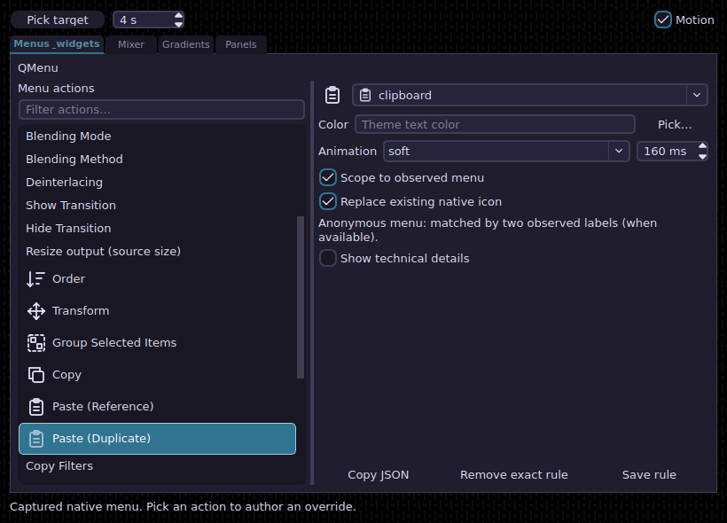

## Workspace and dock controls

**Dock title icons:** Aftermarket draws small, theme-colored vector symbols **before (to the left of)** the real titles of OBS docks, like icon-and-label entries in OBS's context menus: layered frames for Scenes, linked nodes for Sources, mixer sliders for Audio Mixer, arrows for Transitions, a toggle for Controls, a monitor for Preview, and chat/browser symbols for matching plugin docks. Unrecognized docks get a neutral panel icon. Newly added plugin docks and title changes are picked up automatically. The icons are passive and mouse-transparent; they never replace OBS's native dock buttons or drag behavior. To make left-hand space under Qt themes that ignore title styling offsets, Aftermarket temporarily adds display spacing to the on-screen title, while keeping **Docks menu labels unpadded**. The exact original titles are restored on unload or emergency recovery. Icons use 14px or compact 10px artwork when space allows. In cramped native titles, the visible label can elide so the menu remains clickable while the **full original name stays in OBS's Docks menu**. Floating, vertical-title or custom-title-bar docks retain their own window/title controls rather than being overlaid.

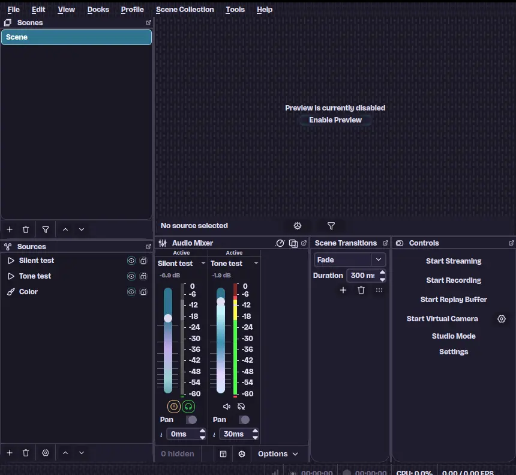

**Three-dot menus on native dock titles:** Every native-titled OBS or plugin
dock gets a theme-colored vertical ellipsis. **Collapse / Expand**, **Pop out**
and **Close** live together in that menu instead of giving Pop out and Close
separate icons in the header. Collapse/Expand still uses the existing Panels
operation and preserves the original dock content. Pop out invokes the dock's
native setFloating(true) action and Close invokes its native close() lifecycle,
without replacing OBS dock identities, toggle actions or the dock's title bar.
These entries have theme-native icons and honor the original Qt feature flags.
OBS deliberately marks its five built-in docks as **not closable**: their Close
entry stays disabled rather than allowing an unsupported action. OBS's
**Lock Docks** also disables the corresponding actions.

While a native dock header has a usable Aftermarket overflow, its separate
native Pop out and Close buttons are hidden and the horizontal title space
reclaimed. If the dock is floating, uses a custom/vertical title bar, is
hidden, or has insufficient room for the overflow, its original Qt window
features/buttons are restored. Emergency restore and plugin unloading likewise
restore them. The Audio Mixer uses this **same dock action group** above its
existing mixer-specific menu items (with no duplicate ellipsis). There is no
extra dock or floating toolbar.

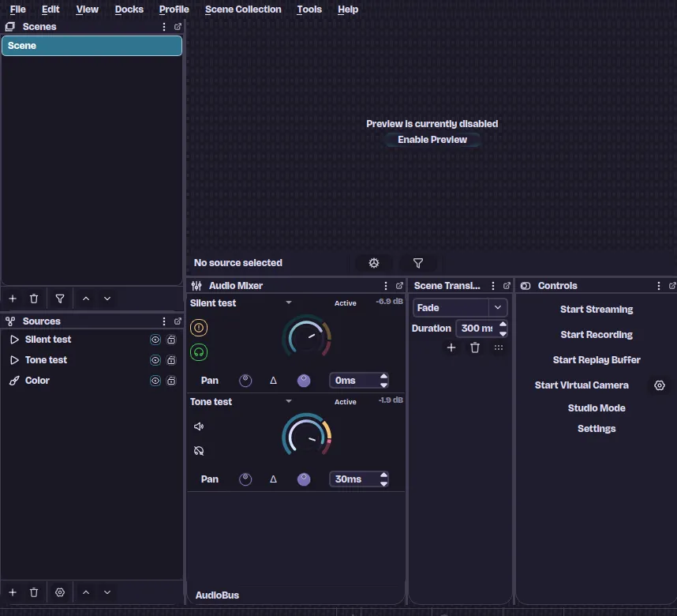

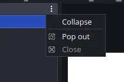

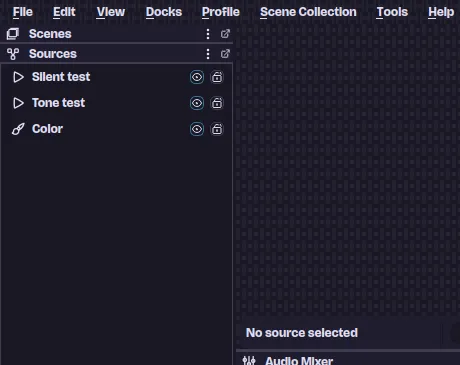

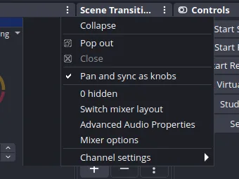

**Text overflow preference:** **OBS Settings → Aftermarket → Appearance → Long text → At end / In middle** sets the preferred ellipsis position. On native Qt lists and tabs, Aftermarket uses their built-in text-elide modes. On OBS's known source-name display labels, middle ellipsis changes only the drawn text, never QLabel::text or its size hint. Aftermarket's own dock titles, AudioBus labels, and submenu-value captions also follow the preference where they own the layout. Full source/model names and the Docks menu remain unchanged. The saved choice is in plugin_config/aftermarket/dock-title-settings.ini.

**Native controls stay native.** Buttons (including OBS's **Filters** and **Properties**), checkboxes, dropdowns, and ordinary labels keep their original Qt/Colorway paintEvent, style sheets, size hints, and text. Aftermarket does not force a custom ellipsis into those widgets: their original theme may clip or elide text according to its own behavior. This intentionally avoids the incorrect Fi…rs / Pro…ies truncation and the shrinking of labels caused by rewriting QLabel::text. Third-party custom-drawn widgets require an explicit, tested adapter rather than a generic application-wide paint interceptor.

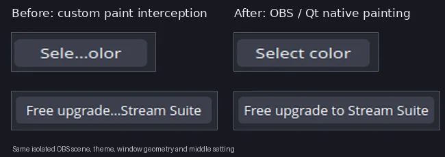

**Same real OBS Sources list, same full names—only the display changes:**

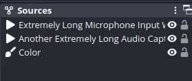

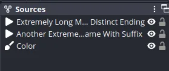

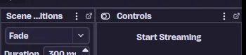

### Collapsible panels

Middle-click a visible dock's title bar to collapse it to its header. Middle-click
again to expand. Alternatively open **Tools → Aftermarket → Workspace → Panels**, select a
panel, and choose **Collapse / expand**. **Expand all** restores all rolled-up
panels. The original dock and its contents stay alive; this does not close the
dock or delete OBS sources.

| Expanded Sources dock | Collapsed Sources dock |
| --- | --- |
| 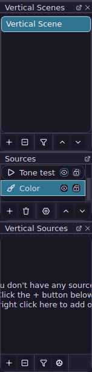 | 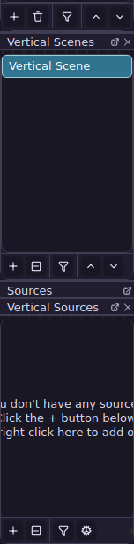 |

The controller temporarily hides dock content and constrains the dock height
to the native header, preserving its width. It asks QMainWindow to redistribute
space and restores the original size constraints and requested dimensions
when expanded. Neighboring dock sizes remain subject to Qt layout negotiation;
pixel-perfect restoration is not guaranteed. Native close/float gestures
are untouched. Floating, tabified and vertical-title docks are excluded from
collapse in this slice. Closing or relocating a collapsed dock restores it.
The collapse state is session-only; no separate collapse settings are persisted.
The controller restores on the main window close event or unload. With Motion enabled, dock height animates over 165 ms; otherwise collapse and expansion are immediate.

Verified in isolated OBS 32.2.0 using Colorway Rosé Pine: Sources collapsed
to a readable title bar at its original column width and expanded to show
the original source list; panel manager collapsed Scenes and Expand all
restored it. Also verified by Qt dock-layout regression tests.

### Dockable video preview

The preview normally stays in the center of OBS. To move it into the native
dock system, open **Tools → Aftermarket → Workspace → Panels** (or the **Panels** tab of the
Inspector) and press **Make preview dockable**. The Preview dock can be
dragged between dock areas, floated, resized, or closed just like the other
native OBS docks.

- **Show preview** reopens the dock after you close its window.
- **Restore fixed preview** returns the **same existing** video preview and
  source-control toolbar to OBS's original central area. No duplicate libobs
  display or scene renderer is created.
- If Studio Mode is on, its existing Preview and Program views stay together.
  In narrow docks, they use OBS's portrait stack rather than extending off
  screen. The original direction returns when docking is disabled.
- Floating begins near the previous dock position at a usable size and
  remains freely resizable. Restoring the original preview is also performed
  on normal OBS window close and plugin unload.

| Docked Preview/Program | Floating Preview/Program |
| --- | --- |
| 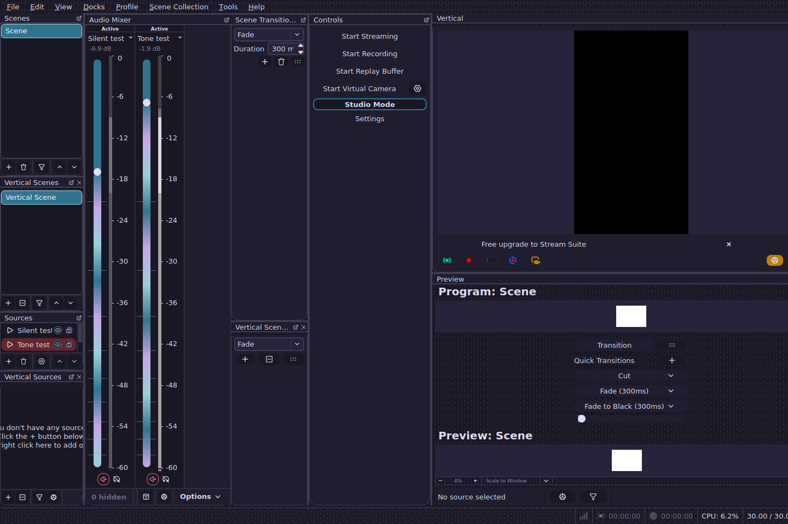 | 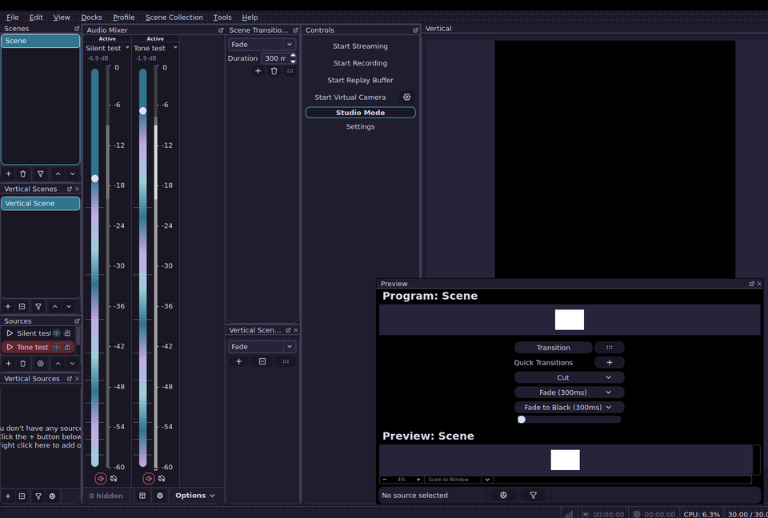 |

### Responsive Studio Mode

Once the preview is docked, a small **Studio** toolbar appears whenever
OBS Studio Mode is active. It provides four session-only display choices:

- **Auto:** side-by-side Preview/Program in wide docks (at least ~900 logical
  pixels), stacked in medium docks, and Program focus in very small docks
  (under ~430 pixels wide or 380 pixels high).
- **Both:** keep the real Preview and Program surfaces visible; in a narrow
  dock, Program receives slightly more of the available height.
- **Program / Preview:** focus that one original OBS display without replacing
  its renderer. Switch back to Both or Auto any time.
- **Transition strip:** the *original OBS control widget* is a compact horizontal,
  scrollable bar in both layouts. It sits between the stacked displays in narrow
  docks and spans the full width below both displays in wide docks. The chevrons reveal the remaining
  native quick-transition buttons and T-bar; their original click handlers
  and sliders are not proxied or replaced.

Program and Preview titles are reduced in the compact layout and their
original font settings return with the fixed preview. Quick transitions
added or removed by OBS update the scrollable width. Switching Studio Mode
off and back on also safely reconstructs the strip.

| Compact dock | Wide floating dock |
| --- | --- |
| 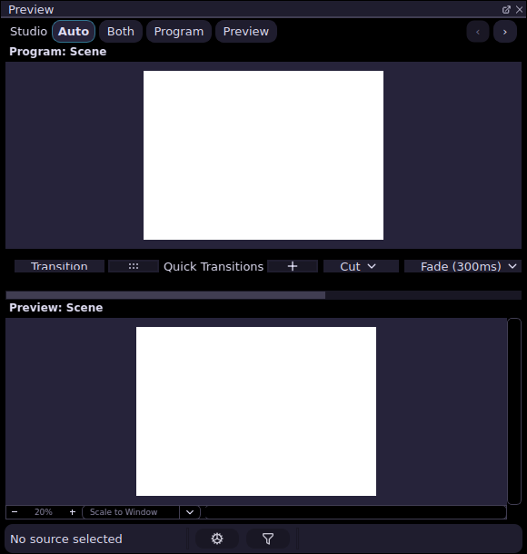 | 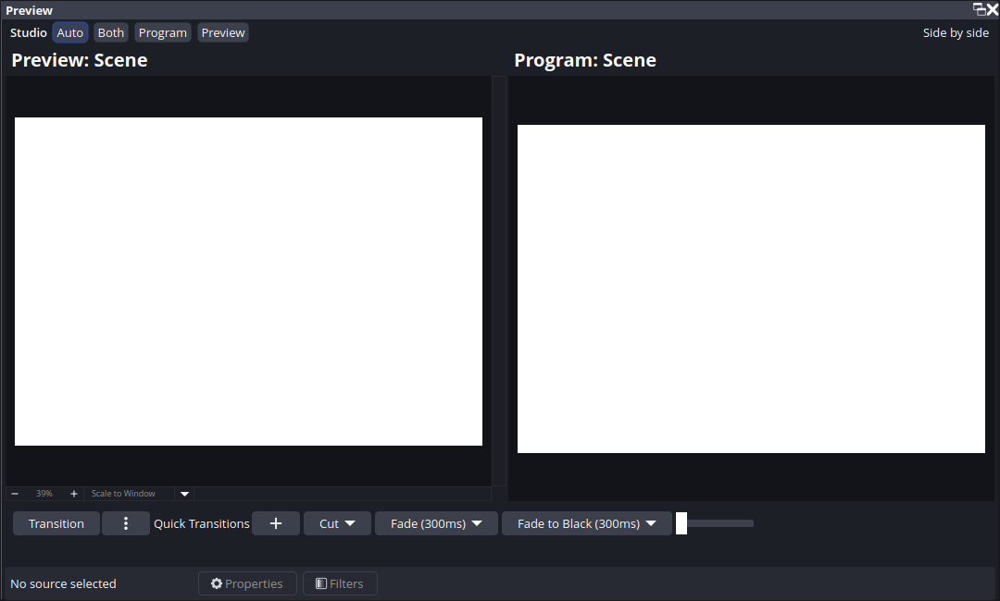 |

**Session-only and opt-in.** It does not change existing theme files or
`rules.json`. The normal OBS File → Exit path was checked in an isolated
test: the temporary dock was absent from the saved DockState. Native display
rendering, Studio Mode toggling and docking/undocking were exercised in
OBS 32.2.0 on X11. Actual streaming or recording, Wayland, Windows, macOS,
and long-running native-display stress remain unverified. The placement of
other docks may shift while the preview is docked; their identities and
contents are preserved, not their exact pixel geometry.

### Saved dock arrangements

Use **Tools → Aftermarket → Workspace → Dock layouts** to save, rename, update, switch and undo native dock arrangements. Add a saved layout to the Action Strip for one-click switching.

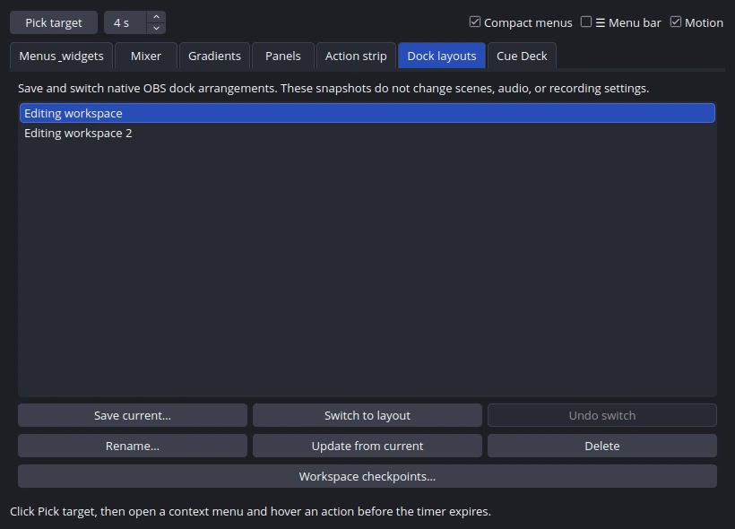

### Source Dock integration

Install [Source Dock](https://obsproject.com/forum/resources/source-dock.1317/) separately.
Use its native Tools → Source Dock manager to create source-specific panels.
Aftermarket recognizes actual Source Dock widgets regardless of their title, uses
a source glyph, and adds **Configure source docks…** to their existing three-dot
menu when the unique localized native Tools action is available. The shortcut
opens the original manager; no third-party widget is replaced. Their native
dock IDs participate in saved dock arrangements and the existing Action Strip
dock selector. Workspace checkpoints include their saved module configuration
inside the native scene JSON.

In Quick Find, select a source or scene and choose **Pin to workspace** to create
a new dedicated Source Dock without switching the active scene. The adapter
resolves the selected source by UUID, chooses a unique dock title, and uses
the installed manager's native Add form, with capability-appropriate preview,
audio, media and scene controls. It does not replace the renderer or mutate
existing docks. Source Dock may omit controls unsupported by the chosen source.
With the workspace-api Source Dock fork, Aftermarket prefers its versioned native creation API and does not open the manager. On stock Source Dock, the adapter checks the known 0.5.1 form structure and the native localized Add
label before creating anything; if incompatible, use the native manager.
Without the optional module, the pin action is hidden. Full workspace restoration is not implemented.

### Independent Source Dock preview refresh

With the workspace-api Source Dock fork installed, open a source dock's
three-dot menu → **Preview refresh**. Select Live, 30, 15, 10, 5, 2 or 1 FPS,
or Freeze frame. Each SDR dock caches and redraws its own viewport; other
displays and Program retain their normal cadence. These settings persist in
the native scene collection and are included in workspace checkpoints.
Non-SDR displays fall back to live rendering. A frozen image is captured
again when the source or cache dimensions change, or when restored from a
saved scene; it is not a saved screenshot. Hiding or collapsing the preview
suspends drawing, releases its showing reference and frees its cache; opening
it restores the saved mode. A frozen preview recaptures after reopening.
The **Controls only** toggle in the dock overflow disables the preview while
keeping the source controls. **Preview refresh → Cached resolution** limits
reduced-rate/frozen previews to a longest edge of 2048, 1280, 640 or 320 pixels
without altering Live or Program. Display presentation still runs at the
usual cadence for visible previews. Stock Source Dock does not expose these
options.

### Off-air frame limiting

Install [Frame Interleave Filter](https://obsproject.com/forum/resources/frame-interleave-filter.1618/)
separately. Right-click an asynchronous video source in Quick Find and choose
**Off-air frame limit…**. Enter the interval in milliseconds (0–1000).
For example, 100 ms targets roughly ten incoming frames per second when OBS
considers the source inactive; 500 ms targets roughly two. The upstream
filter bypasses limiting for active sources. Actual cadence depends on OBS
and source frame timing. This is a source-wide asynchronous frame limit,
not an independent Source Dock refresh rate, decoder throttle or guaranteed
GPU savings. It can affect all previews of that source.

Aftermarket creates a marked native filter only after explicit confirmation,
updates only its own filter, and removes only that filter at zero. Existing
manually configured or duplicate Frame Interleave filters are left untouched.
The action is absent for synchronous sources, scenes, filters and when the
optional backend is unavailable. Native scene saves retain the settings.

### Workspace checkpoints

Open **Tools → Aftermarket → Workspace → Dock layouts → Workspace checkpoints…**.
Create a named checkpoint to request a native OBS save, verify that the current collection
was written, and capture its scene JSON, current native dock state, plus existing
Aftermarket rules, Action Strip, Cue Deck, layout library, mixer ordering, device
visibility, dock title and source picker settings. Missing configuration files
are recorded rather than invented. The manager keeps up to 32 local, checksum-verified
bundles in `plugin_config/aftermarket/workspace-checkpoints`; it never overwrites an
existing checkpoint. Invalid bundles remain untouched.

**Restore docks only** is a confirmed native layout change, requiring all saved docks.
**Export scene** produces an OBS-importable scene JSON. **Export recovery folder**
exports the scene, captured Aftermarket files, native layout preset and recovery
instructions without overwriting an existing destination. Import scenes through
OBS and recover individual settings only with OBS closed, after backing up the current
configuration. Full live restoration, profile/output settings, media files and
third-party plugin binaries are not included. Scene JSON may contain private source
settings; keep exports local. When [Scene Collection Manager](https://obsproject.com/forum/resources/scene-collection-manager.1434/)
is loaded, the checkpoint dialog offers **Also create a Scene Collection Manager backup**.
This is unchecked by default and invokes the manager's registered backup hotkey only after
the Aftermarket checkpoint is safely saved. Its configured backup folder and retention rules
apply; Aftermarket does not change them. A new backup is reported as verified only when its
scene data matches the saved checkpoint (excluding the manager's timestamp name).
If dispatch or verification fails, the independent workspace checkpoint remains intact.
The adapter conservatively skips collection names whose sanitized filename cannot be matched
to OBS's actual collection file, and avoids known same-second backup filename collisions.
The **Open Scene Collection Manager…** shortcut in Dock Layouts opens the real third-party
manager after closing the layout dialog. No automatic restore hotkeys are invoked.
If the plugin or a unique registered hotkey is unavailable, the associated controls are omitted.

See the [dock layouts reference](dock-layouts.md) for persistence, missing-dock guards and rollback behavior.

### Compact hamburger menu bar

**Tools → Aftermarket → Workspace → Menus & widgets → ☰ Menu bar** replaces OBS's
top-level File/Edit/View/Docks/Profile/Scene Collection/Tools/Help labels
with one hamburger entry, using **the same native Qt menus and actions**.
Click it to access every original submenu, including items registered by other
OBS plugins. The longer category names have room for their submenu arrows.
The existing **Compact menus** checkbox is separate: it controls long popup
layouts, not the top menu bar.

The hamburger mode is **off by default** and saved under
`"hamburgerMenuBar": true` in `rules.json`. Switch it off to restore the
classic menu bar immediately, without restarting OBS. Qt provides an
**Alt+M** shortcut, with the regular native menu/navigation behavior retained;
the shortcut was checked in the Qt regression harness, not in every desktop
window manager. Late plugin-added top-level menus are placed in the hamburger,
and enabling/disabling never duplicates or replaces OBS's actions or submenus.
The remaining menu-bar space can hold the optional Action Strip described below.

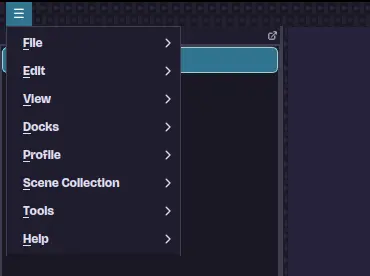

### Action Strip

**OBS Settings → Aftermarket → Action strip** controls visibility and
opens the button editor. The **Action strip** tab in Tools → Aftermarket → Workspace also opens the same editor. Choose
**Show OBS action strip** to place your configured items at the
right of the *existing* native menu bar, including when the hamburger is off.
It is **off by default** and does not replace OBS's Controls dock, native
menus, hotkeys, scene collection or status bar.

Available items:

- **Status:** REC/stream activity, recording or stream elapsed time, FPS,
  CPU, dropped *stream* frames, missed *render* frames, live recording and
  streaming bitrates. Metrics share one periodic refresh; the stream/record
  clocks follow OBS's frontend start/pause/resume/stop events. If the plugin
  attaches to a session that already started, elapsed time displays
  **--:--** instead of inventing a start time.
- **OBS hotkeys:** Search a grouped list of actual frontend, plugin, source,
  output, encoder and service hotkeys. The persisted identity includes the
  registering owner (source UUID where available), not just the displayed
  name. Missing/ambiguous hotkeys become inactive; they are never reassigned
  to an unrelated source.
- **Native dock buttons:** Show/hide any dock with an identifiable OBS dock ID.
  Buttons show the full native dock name (**Controls**, not `controlsDock`)
  when no custom label has been set; user-defined labels take precedence.
  Checked means visible; the tooltip and accessible name say **Hide Controls**
  or **Show Controls**, as appropriate. Overflow menu entries keep the same
  label, enabled state and checked state. Missing docks stay disabled rather
  than silently toggling a different dock. OBS's dock widgets are not replaced.
- **Saved dock layouts:** switch arrangements by stable saved identity. Missing layouts become inactive.
- **Find sources:** open the Quick Find palette from the strip.
- **Flexible spacers and separators** for arranging groups.

Drag controls to reorder them directly on the strip, or use the editor's
move buttons. Right-click an existing control to rename, move or remove it.
The bar uses the active OBS Qt palette and existing typefaces, with the same
subtle checkable-button style as other Aftermarket controls. When there is
not enough horizontal room, excess items move to a working **⋯** overflow
menu instead of becoming tiny or cut off.

Its configuration lives in the independently and atomically saved
`plugin_config/aftermarket/action-strip.json`. The emergency shortcut
**Ctrl+Alt+Shift+F12** hides the strip and restores OBS's original menu
corner widget; **Resume UI customizations** recreates it with the same saved
items and enabled preference. Aftermarket also makes bounded attempts to
attach the *existing* optional Audio Mixer backside when OBS creates its
dock late, and stops retrying on emergency recovery. It does not copy Timeline's macro data.

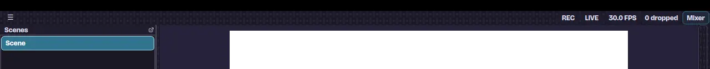

## Sources and navigation

### Cue Deck

**Tools → Aftermarket → Workspace → Cue Deck** opens the embedded cue manager.
Cues are named ordered action sequences—not new OBS scenes or copies of any
third-party animation engine. Use **New cue**, enter a name, then add steps:

- **+ Layout:** pick a saved Aftermarket dock layout.
- **+ Hotkey:** pick a registered **native OBS or plugin hotkey** by group
  and readable name. This can include Exeldro Move's per-source start/hold
  actions *when OBS has registered them*.
- **+ Wait:** insert a delay (1–30,000 ms) between actions.
- Move steps **Up**, **Down**, or **Remove** to arrange the sequence.

Use **Run cue** to dispatch the sequence; **Stop** cancels pending steps but
does not undo actions already sent to OBS. Running a cue is an explicit
on-air-capable action. A hotkey may start/stop a stream or trigger a scene
transition, depending on its own OBS/plugin behavior. A completed cue means
all supported actions were **dispatched**, *not* that a third-party animation
or scene transition finished.

Cues store stable native layout IDs and OBS hotkey owner identities rather
than mutable names. Missing plugins, removed source hotkeys, deleted layouts,
and ambiguous identities fail preflight before any action executes. If an
action disappears **during** a sequence, dispatch stops at that step; earlier
steps are not rolled back. Cue definitions remain stored so temporarily
unavailable plugins do not erase your work.

To add one-click playback, use **Tools → Aftermarket → Workspace → Action strip → Edit buttons and status readouts… → Add…
→ cue**, select the saved cue, and enable the Action Strip if necessary.
Renaming a cue updates its button caption; deleting it disables that button.

Cue definitions are atomically written to
`~/.config/obs-studio/plugin_config/aftermarket/cue-deck.json`.
Up to 32 cues, each up to 48 steps, are supported; total waits per cue are
limited to 120 seconds. Existing scene, filter, and plugin configurations are
never rewritten by creating or editing a cue.

This first implementation uses existing plugin hotkeys for interoperability;
it does not add vendor-specific Exeldro parameter editing, visual animation
previews, completion callbacks, or a general WebSocket macro adapter. Those
need explicit compatibility and runtime testing before being described as
available.

### Embedded Add Source picker

Aftermarket presents OBS 32.2's native Add Source workflow in a compact panel
beside Sources (up to 380 × 400 pixels). **Add new** lists source types as
scrollable, icon-sized rows: click a type once to create it and open its
native Properties editor. **Add existing** has a separate source-type selector
and case-insensitive name filter. Recent sources uses OBS's recent-source
list; select a source type to browse all existing sources of that type.
Existing rows show 64 × 36 previews from OBS’s native thumbnail cache,
with source-type icons when no video preview is available. Preview updates
follow OBS’s own thumbnail scheduling; Aftermarket does not render additional
source frames. Select a row, then use the native Add existing action. Both modes share
Make source visible.

The original large thumbnail layout is hidden, not resized into the small
panel. The picker is a frameless modal dialog owned by OBS and positioned
inside the main window bounds, rather than an ordinary child widget. This
keeps it above native graphics surfaces; custom transform handles yield
while a modal dialog is active. OBS still owns source identity, creation, selection, add-existing
callbacks, undo and Properties. The panel stays within the main client area;
unknown dialog structures, hidden Sources docks and insufficient initial
space retain OBS's original picker.

The option is **enabled by default** on compatible OBS installations and
can be turned off under **OBS → Settings → Aftermarket → Appearance →
Embed Add Source picker in OBS**. It takes effect the next time Add Source
opens; changes in native Settings follow **Apply / OK / Cancel**. Its only
persisted option is sourcePicker/embedded in Aftermarket's
plugin_config/aftermarket/source-picker.ini; it never modifies OBS
source or scene files.

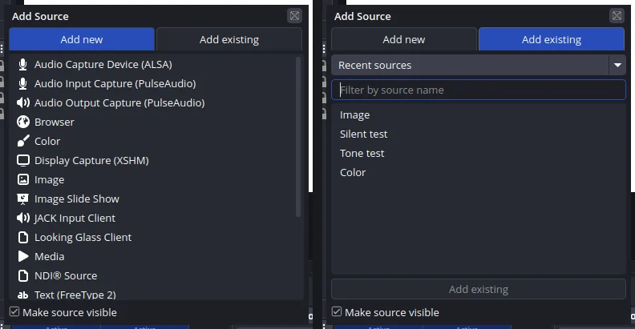

### Quick Find: jump to sources and filters without another dock

Open **Tools → Aftermarket → Find Sources…** to search the current OBS scene
collection in a compact, temporary palette. The search matches **source,
scene, and filter names**, OBS source types, and common source file paths or
URLs. Results show a parent-scene context when known. Filtering is local to
OBS; it doesn't send content elsewhere.

- **Enter** opens the selected result: a scene/source with an available parent
  scene navigates to that scene, while a filter opens its **owning source's**
  native Filters dialog. When Studio Mode is on, scene navigation targets
  the **preview**, not the on-air program.
- **Properties**, **Filters**, and **Go to scene** are independent actions.
  Typing in the search box does not change the live scene or source settings.
  **Refresh** rebuilds the source index if something changed while it was open.
- For one-click entry, add **Find sources** in the existing
  **Aftermarket → Workspace → Action strip → Edit buttons and status readouts… → Add… → search** editor.
- For keyboard entry, assign a shortcut to
  **Aftermarket: Quick Find sources and filters** under
  **OBS Settings → Hotkeys**. No conflicting shortcut is assigned by default.
  OBS saves the custom binding in its scene collection.

The palette stores source identities by UUID and resolves them again before
opening an OBS dialog or changing scenes. Deleted sources and stale filters
are rejected instead of being redirected to another source. It is not a
replacement for Quick Access Utility's manual/dynamic docks, and it doesn't
modify OBS's docking layout.

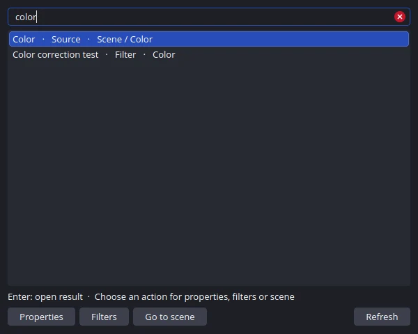

### Alternating Scenes and Sources backgrounds

In **OBS Settings → Aftermarket → Appearance**, turn on **Scenes** and/or
**Sources** alternate rows independently. The Inspector's detailed
**Panels → Alternating list backgrounds** editor remains available for
choosing custom row colors. By default both are off.
**Normal rows** and **Alternating rows** can each use a chosen solid color
or **Use theme** to return to native Colorway/OBS styling. **Strength** controls
the alternating-row contrast for Scenes and Sources together: **0%** removes
the difference between normal and alternating backgrounds, **100%** uses the
original theme/chosen colors (the unchanged default for existing settings),
and **200%** doubles the color difference with RGB values clamped safely.
It uses the existing theme's colors unless you explicitly choose custom
ones; selection, hover and source-specific coloring remain native.

The Strength slider is available in **OBS Settings → Aftermarket → Appearance**
and **Tools → Aftermarket → Workspace → Panels → Alternating list backgrounds**.
The Inspector previews changes while you drag and saves on release. Native
OBS Settings stages the value until you choose Apply or OK; Cancel discards
unapplied edits. The settings are stored atomically as listRows.strength in
rules.json, and turning stripes off restores the original palette and
stylesheets.

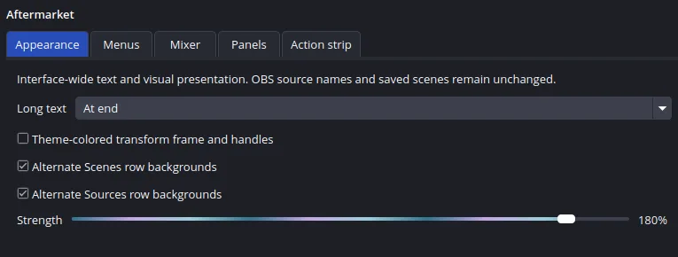

This augments the **existing OBS widgets**. The built-in scene selection and
hover colors remain native; source-specific row colors assigned through OBS
are preserved. Scene *grid mode* stays untouched. Other OBS/third-party lists
are deliberately excluded until their native behavior can be checked.

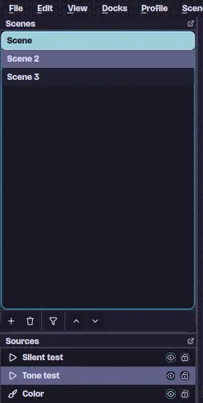

## Mixer and AudioBus

Enable **AudioBus alternate routing view** in **OBS Settings → Aftermarket → Mixer**. The native Audio Mixer and AudioBus remain **two alternate views inside the same dock**, not two vertically stacked panels. Only the **interactive AudioBus switch** has moved to a small bottom-edge control: click **AudioBus** to open the routing view, then **Audio Mixer** to return. The original OBS audio controls are preserved, and emergency recovery **Ctrl+Alt+Shift+F12** restores the native mixer without changing scene or audio routing.

**Audio channel sizing:** OBS audio channels size from their controls and available layout space, **not from the length of their names**. Vertical channels use OBS's own width allowance (up to its native 110-pixel limit), rather than artificially restricting every label to 68 pixels. Names such as Live Latent: TTS stay fully visible when they fit; genuinely long names truncate only at the actual channel boundary. Horizontal mixer rows also retain their available label space. The complete OBS source name and native mixer controls are unchanged, and the original label sizing policies and minimum widths are restored on detach/emergency recovery.

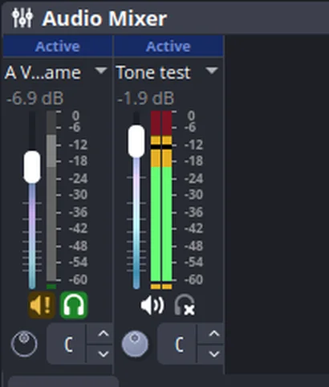

**Manual channel order:** Open the mixer title's three-dot menu and enable **Unlock channel ordering**. Drag a source name onto another channel to move the complete native channel, in either mixer orientation. Disable the same option to lock the saved positions. Order is saved by OBS source UUID (not display name), retained across temporarily hidden channels and reapplied when native channel widgets are rebuilt. New channels follow the saved channels; **Reset channel order** clears the saved order and restores the original native layout. Ordering starts locked on restart. This changes presentation only, never gain, routing, or the OBS Sources list. AudioBus follows the same saved order as soon as its face opens, with additional routes appended in their normal order. Reset returns AudioBus to its default source ordering. Unsupported native layouts are left untouched.

**AudioBus (alternate routing view)** is a compact source-to-output patchbay:

- **Click a source node to select it**, then click a numbered destination to toggle its route or drag the source to connect. Clicking an already-connected track toggles it off; repeating a drag never disconnects it. **Show all wires is enabled by default**, showing every source connection immediately. You can turn it off in the dock menu for a selected-only view. Hovering a source or output highlights related paths without modifying routing or hiding unrelated wires while the all-wires view is enabled.
- **Routing display controls are in the Audio Mixer dock’s three-dot title menu, only while AudioBus is open:** **Show all wires** is a native checkable menu action that opens **checked by default**, and **Refresh audio routes** re-queries OBS immediately. Their separate checkbox and refresh button have been removed from the routing header. Reopening the menu preserves the wire toggle state, while normal automatic route/signal refresh continues. The menu, checked state, hover/focus presentation, fonts and refresh glyph honor OBS’s current Qt theme: the refresh shape comes from QStyle, tinted with the menu’s actual text palette rather than the desktop icon theme. Switching back to the original Audio Mixer hides the routing-only menu entries.
- The six **circular output nodes** represent OBS's actual tracks 1–6. The separate circular **headphones node** represents OBS monitoring, not Track 7. **Left-click** the headphones to toggle Off / Monitor and Output for the selected source; **right-click** it for the three-mode menu (**Off / Monitor Only / Monitor and Output**). There is no bottom monitoring dropdown. Dragging to headphones preserves an existing Monitor Only connection and never rewrites track assignments. The selected source is identified by OBS UUID, not its potentially duplicated or renamed display name.
- **One outline per node, two distinct colors:** selection is blue (the theme's Link role), and **measured active audio is green** when the theme's Highlight and Link colors would otherwise both be blue. Colors remain palette-derived, adapting to OBS themes. A selected source retains its blue outline whether silent or active; an **unselected active** source and active output circles use green. Selection takes precedence, without a second ring or activity dot. Inactive unselected nodes stay subdued. Output activity aggregates the eligible routed sources and respects Monitor Only. Tooltips retain the distinction between silence, muted, and unknown states. The source-type icons remain on the left, and removing the dots makes extra room for longer source names. All highlights use the active OBS theme palette. A highlighted output **does not prove a physical playback device is audible**.
- The graph owns source selection and routing, so the **Outputs** heading, duplicate source selector, lower output-button row, bottom Monitor dropdown, and verbose stats are gone. Clicking or dragging to the circles keeps native OBS routing behavior; clicks on transparent square corners do not toggle a circle. In narrow docks the headphones stay pinned at the top. Hover previews and **Show all wires** continue working.

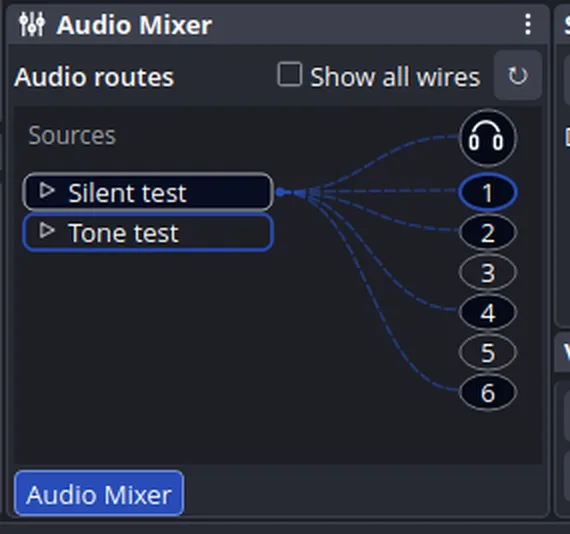

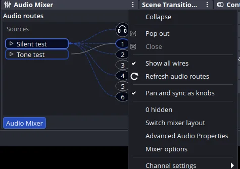

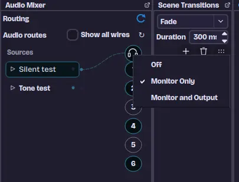

### Independent device sends (optional Audio Monitor integration)

Install [Exeldro's Audio Monitor](https://obsproject.com/forum/resources/audio-monitor.1186/) and restart OBS. When its real `audio_monitor` filter type is registered, AudioBus discovers playback devices through OBS. They appear as named destinations below the six track circles; the native headphones destination remains separate. Refresh audio routes or reopen AudioBus to discover device changes. Without the optional plugin, no device nodes or substitute playback engine appear. In the routing title menu, **Device destinations** shows a checkable list of available playback devices. Uncheck a device to hide its node and wires without interrupting playback or removing filters; visibility is saved by device ID in audio-device-visibility.json and restored across restarts.

- Drag a source onto a device to create an actual Audio Monitor filter, initially at 50% gain. Dropping an already-connected source is idempotent. Click a device with a source selected to remove an Aftermarket-created send; existing independently created filters remain read-only.
- Right-click a device for the selected source, or right-click an existing device wire, to edit gain (0–100%), pan (−100% to +100%), and delay (0–10000 ms). A wire intersection offers source/destination choices rather than silently choosing a route. Each edit writes to the filter's OBS settings. **Mute independent send** preserves the chosen gain while setting the actual filter gain to zero; changing gain while muted updates the value restored on unmute. The mute survives automatic filter re-enabling on scene activation. Muted and disabled sends retain their dashed wires. Independent filter enable and other advanced settings remain available in OBS Filters. No native fader, track mask or monitoring mode is changed by these edits.
- Sends are real scene-collection filters and survive Aftermarket UI recovery or unload. Use Remove independent send or OBS Filters to remove them. Existing linked or source-mute-linked filters are not changed through these parameter editors. Offline/unlisted devices and plugin-specific advanced destinations may still be managed through OBS Filters.
- An independent send may be audible even when the source is muted on the native mixer. Aftermarket starts new sends in Audio Monitor's inactive-source mute mode and leaves native source mute linking disabled. Direct matching output-capture device loops are rejected when identifiable; other feedback paths are possible. Avoid routing captured desktop audio back into its capture device. Device nodes do not claim to measure the physical output signal.

**Native mixer title and bottom control:** After **Collapse/Expand**, **Pop out**, and **Close**, the **vertical three-dot button in the genuine OBS dock title** opens the pan/sync presentation setting and the original **hidden sources, mixer orientation, Advanced Audio Properties and Mixer options** actions, plus a **Channel settings** submenu with per-source native Pan and Sync editors. The old OBS footer is hidden only when the header menu is actually available; floating or cramped docks restore it, so controls remain accessible. The interactive **AudioBus** button lives by itself at the dock's bottom edge and switches between mixer and routing pages, never stacking the entire routing graph below OBS. Dock icons, native titles and drag behavior remain native; undock and close actions are now consolidated into the header overflow when available.

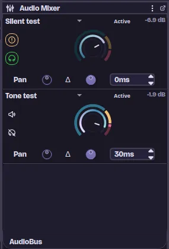

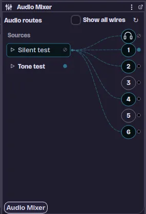

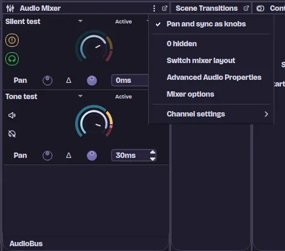

**Controls within the mixer:** Pan and Sync offset remain horizontally aligned in one compact row per OBS source, rather than two vertically stacked rows. Narrow vertical strips use a pan dial and a precise millisecond spinner; horizontal mixer strips use the same one-row layout. Pan maps to native OBS balance (0 = left, 50 = center, 100 = right), with mono pan disabled; the coarse sync dial spans ±2000 ms and the precise editor supports OBS's wider range. The vertical fader/meter geometry stays native — no compression is needed when the patchbay uses a separate page. No fader, mute button, source identity or monitoring state is replaced.

Pan and sync are read from and written to the same source properties shown in **Advanced Audio Properties**. Adjustments request a debounced OBS project save; the separate atomic `plugin_config/aftermarket/front-audio-controls.json` holds only the slider/knob presentation preference. External source changes are read back while the dock is visible, and all additional widgets detach cleanly.

**Monitoring note:** the physical Monitor Device is selected under **OBS Settings → Audio → Advanced**. Routing a source to an already-captured monitor device can cause echo/feedback. Monitor Only suppresses normal program output even if track assignments remain enabled. Native OBS monitoring still uses that one device. Independent device sends, when available, use the optional Audio Monitor backend; Aftermarket performs no arbitrary DSP/bus routing. With many sources, the diagram can still scroll.

### Patchbay routing diagnostics

The **AudioBus** routing view exposes native OBS tracks 1–6 and monitoring, plus optional independent device sends.
Source tooltips distinguish muted, disabled, OBS-inactive, silent and unknown
signal states. Measured activity drives the palette-derived node outlines;
selection takes precedence. OBS's audio-active flag alone does not prove
audibility, and a highlighted output does not establish that physical sound
is reaching a monitor device.

Hovering and inspecting do not modify routes. Explicit track clicks, source
drags and monitoring controls edit native OBS routing. Aftermarket does not
inspect or modify atkAudio PluginHost2 graphs or VST chains. Independent device sends are managed only via Audio Monitor filters.

### Rotary mixer knobs

Open **Tools → Aftermarket → Workspace → Mixer** and check
**Replace mixer faders with knobs**. Enable All mixer sources to replace every
mixer fader, or select specific sources in the checklist (e.g.
`Mic; Music`). Apply without restarting OBS. For now this is limited to mixer
sliders, not seek bars or arbitrary settings controls.

Click and drag a knob up/right to increase volume, down/left to decrease.
There is no value jump on initial press. The original QSlider stays in the
layout and owns range, tracking, value, slider signals, focus, and existing
keyboard/wheel behavior. Its native paint is suppressed while a mouse-transparent
child draws a rotary ring and pointer. Enough minimum size is requested to
fit the knob, subject to the native maximum and surrounding layout constraints.

Knobs work independently of Enable gradient tracks, using native palette colors.
With Sliders and gradient tracks enabled, the ring uses the same configured
palette, motion and optional per-source audio-reactivity as faders.
Toggle knobs off to restore the native slider and its original size constraints
where those have not been changed by another owner. The current volume is preserved.

```json
{
  "knobs": true,
  "knobSources": ["Mic", "Music"]
}
```

Merge these keys into the existing gradient object. Source names are scoped
exactly, not durable source UUIDs; the text UI uses semicolons as delimiters.

[Earlier mixed knob/fader verification](screenshots/knob-mixer.png).

Verified in isolated OBS 32.2.0 with Colorway Rosé Pine: Tone test switched to
a knob, Silent test remained a fader; the reactive ring animated (242 changed
pixels, silent fader zero); native volume moved from -12.0 dB to -3.5 dB after
a drag; disabling knobs restored the slider at -3.5 dB. Qt regressions cover
target selection, slider signals, programmatic updates, native key handling,
invalid config and restoration. Horizontal mixer layouts, live source rename
and theme changes under knob sizing need further real runtime testing.

### Integrated knob meters

Knob-enabled mixer channels now default to a combined rotary control rather
than a knob alongside a tall native meter. The inner ring shows gain, the
outer ring shows actual peak dB from the source's libobs volmeter. Metering
continues even with decorative Motion disabled. Native nominal, warning and
error colors are reused, with -60 to 0 dB scale, -20/-9 dB thresholds, a
one-second peak marker, clip flash and 30 dB/s release.

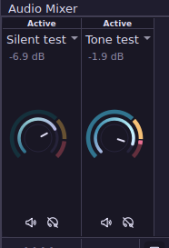

The native meter is hidden only when paired with the supported knob and
source can be resolved. It is restored if the binding is unavailable or
the effect is disabled. Disable **Integrate peak meter into knob** in
Tools → Aftermarket → Workspace → Mixer to retain the full native meter.
The corresponding JSON key is `gradient.knobMeters` (default true).
The compact control requests a 68-pixel minimum and 76-pixel maximum height
subject to native constraints. The OBS setting for sample/true peak is used.

This is a combined maximum-channel peak display, not a reproduction of the
full multichannel OBS meter, magnitude and input-peak indicators. Use the
native meter for detailed stereo/monitoring work, particularly when checking
levels against the scale or custom threshold settings. The ring does not
modify source gain; the existing inner gain control continues to operate the
original slider. Real vertical mixer verification: one selected knob
replaced only its paired meter, mute cleared the outer ring without moving
gain, both knobs could be selected, and dragging changed the real dB label
from -1.9 to 0.0 dB. Live disable restored the original meter.
The meter scale remains visible at silence and mute, using dimmed native zone colors. Horizontal and vertical layouts have been exercised in isolated OBS, including switching orientation; theme-driven slider size changes are reconciled. Source renaming/rebuilding remain open.

### Audio-reactive mixer effects

In **Tools → Aftermarket → Workspace**, enable gradient tracks on Gradients, then open Mixer and enable
**Audio-reactive mixer gradients**, and optionally **Pulse native meter colors**.
Enable Motion in the inspector. The effects are opt-in and can be toggled live.

- Each mixer fader follows its own source's libobs magnitude, not the global
  clock or another channel. Audio energy accelerates gradient flow and raises
  brightness; silence or mute brings the effect to rest. The native slider
  position and volume never change.
- The native meter's nominal foreground color responds to the same envelope
  by brightening its current theme color. This is a color modulation, not a
  replacement meter renderer. Warning, clipping, disabled colors, magnitude
  and peak-hold geometry remain under OBS control.
- Non-mixer sliders and progress bars retain the time-driven gradient behavior.

The exponential envelope uses 55 ms attack and 220 ms release.
Audio callbacks publish only a numeric magnitude and timestamp; no waveforms
are retained and no audio is sent anywhere. Source identity is matched to the
full current VolumeName button label; weak source references are revalidated.
No private OBS object offsets or ABI casts are used. Probes are released after
the associated controls stop requesting levels, or when the effects are disabled.

Add these keys to an existing gradient object:

```json
{
  "audioReactive": true,
  "meters": true
}
```

[Reactive mixer verification: tone and silent sources](screenshots/audio-reactive.png).

Verified with real OBS 32.2.0, Colorway Rosé Pine, two isolated media sources
and no active recording or streaming: 1218 changed pixels on the tone fader
versus zero on the silent fader. Turning Motion off restored the native meter
nominal color (325 changed pixels); sampled warning/clip and silent-meter regions
were unchanged. Native mute stopped the tone fader effect after release.
The Qt tests also verify independent envelopes, unchanged slider values, theme
base updates and configuration persistence. This first slice is magnitude-driven,
not beat detection or FFT. OBS named-token resolution and full gradient painting
inside meter bars remain future work.

### Animated gradient tracks

Open **Tools → Aftermarket → Workspace → Gradients**. Turn on **Enable gradient tracks**, select sliders and/or progress bars, and apply. Enable the inspector's global **Motion** toggle for flowing gradients. The defaults leave existing configurations untouched.

- Sliders and media seek bars: gradient follows native slider position, including vertical faders, inverted appearance and right-to-left geometry. The native thumb and input stay intact.
- Determinate progress bars: fill follows the widget's actual range and value; text-bearing bars use a thin accent strip to preserve native text. Indeterminate, empty, hidden and disabled tracks are not painted.
- Colors: leave blank for the native palette, or specify 2–6 opaque colors separated by commas. Loop duration is adjustable from 400–12000 ms.

```json
{
  "enabled": true,
  "motion": true,
  "gradient": {
    "enabled": true,
    "sliders": true,
    "progress": true,
    "period": 1800,
    "colors": ["#31748f", "#c4a7e7", "#9ccfd8"]
  },
  "rules": []
}
```

Edit just the gradient and motion fields in an existing file to preserve your menu rules. The inspector merges settings into the existing file, atomically. Changes apply without a theme reload or restart; the rules watcher also reloads valid external edits. Motion off freezes the gradient; gradient off removes the decoration entirely.

The overlay derives groove, thumb and progress content rectangles from Qt's actual style geometry. Slider gradients extend to the native thumb center, preserving the actual handle silhouette instead of leaving a rounded gap before it. A cached native-paint comparison covers the exposed page around the thumb; solid-color antialiased edges are recomposited over the animated fill. Ambiguous custom handle pixels remain native. It uses a seamless repeated gradient and one shared 30 Hz timer, which stops if there are no visible, nonempty animated tracks. It never writes slider values or changes the stream compositor.

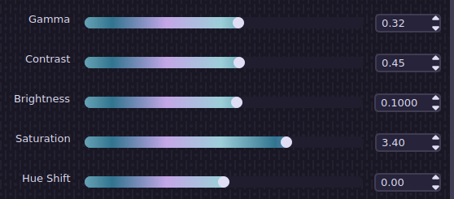

[Earlier media seek and fader verification](screenshots/gradient-tracks.png).

Verified in an isolated OBS 32.2.0 session with Colorway Rosé Pine, native media playback and mixer fader. Both tracks' pixels changed while paused elapsed text stayed fixed; native seeking updated playback position. Live motion-disable made the pixels stable, and live gradient-disable restored the native appearance. Qt regression tests cover progress bars, vertical and inverted sliders, stylesheet geometry, invalid configuration and reduced motion. Progress bars were tested in Qt, not a specific OBS progress dialog. Custom-drawn controls that are not QSlider/QProgressBar are outside this slice.

## Menus and rules

### Compact menus

Long *choice lists*, such as the Add Filter menu, use tighter rows and
balanced, visible columns, typically aiming for about 340 logical pixels in
height. The regular OBS **Source context menu stays a single column** with
compact spacing, preserving its familiar command layout. No commands are
automatically moved behind another menu. If a list cannot fit within the
available screen space, native navigation remains available. Expanded columns
keep the popup anchored to the control that opened it, flipping above or to
the left when needed rather than inheriting the original narrow menu position.
The opening monitor and native action hit targets are preserved. Submenus anchor to the actual triggering row and stay on its monitor.

| Source menu | Filter picker |
| --- | --- |
| 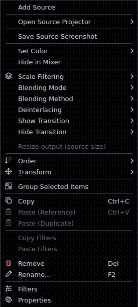 | 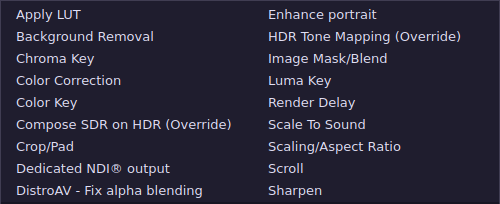 |

Use **Tools → Aftermarket → Workspace → Compact menus** to enable or disable
the layout (enabled by default). Pick a particular action and check
**Move to More actions** only if you want that specific command tucked
away. Placement rules are stored independently in the root-level
`menuOverflow` array; existing icon rules are unaffected. Capture the action
again in More actions and uncheck it to restore its normal placement.

For OBS Appearance settings, the Theme and Style combo boxes with at least
16 choices open a searchable, scrollable grid; all choices remain present
until the user deliberately filters them. Long theme names use the full
allocated grid-cell width rather than being clipped to their intrinsic label
size; titles exceeding screen-constrained cells still have tooltips. Selection
commits to the original combo box's model. Unrelated and editable combo boxes
are left unchanged.

The native column adapter is built for Qt 6.4.2 with its private development
headers (on Debian/Ubuntu, qt6-base-private-dev) and requires a matching
runtime version. Other versions fall back to compact native rows rather
than accessing mismatched private layout data. Short menus, embedded
widget actions and tear-off menus keep their native layout. The active
theme supplies colors and type.

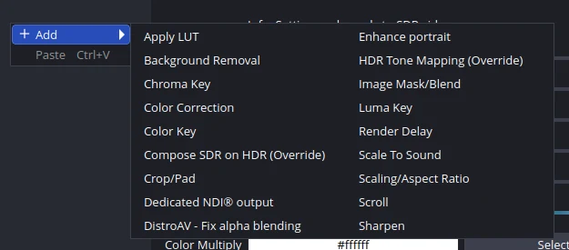

### Context-menu actions

Aftermarket can now customize the **contents** of a native context menu,
rather than only its appearance. Open **Tools → Aftermarket → Workspace**, pick
the target menu, then use the **Menus & widgets** page:

- **Hide this default entry** removes that selected command only from
  matching popup menus. The actual OBS QAction, its signals, and its original
  state are preserved. The entry returns when the rule is removed.
- **Add custom…** creates a labelled entry with an optional icon, an
  executable, and an argument list. These entries appear at the bottom of
  the captured menu and execute only when selected.
- **Manage entries…** edits or removes custom entries and restores hidden
  defaults. **Show all menu changes** works even with no menu captured, so
  it remains a recovery path if every entry was hidden.

The editor scopes changes to the captured menu by its native object name
when available, or by observed action labels for anonymous menus.
Unchecking **Scope to observed menu** while hiding a native entry permits
an explicitly broader match. No original OBS action is deleted.

Custom commands invoke the specified executable directly with its argument
list, **without automatically launching a shell or substituting selection
values**. Enter trusted commands only. Example excerpt (merge into your
existing `rules.json`; do not replace the entire file):

```json
{
  "menuHidden": [
    {"text": "Remove", "menuContains": ["Add Source", "Open Source Projector"]}
  ],
  "menuCustom": [
    {
      "id": "open-my-tools",
      "label": "Open my tools",
      "program": "xdg-open",
      "args": ["/home/me/tools"],
      "menuContains": ["Add Source", "Open Source Projector"],
      "icon": "monitor"
    }
  ]
}
```

These keys are added to the existing `rules.json`; they do not replace the
original `rules`, `menuOverflow`, or gradient settings. Add commands from
the inspector to generate unique IDs automatically.

| Customized native menu | Recover or edit saved entries |
| --- | --- |
| 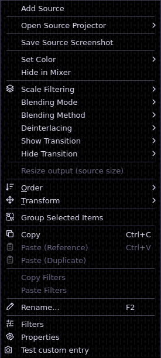 | 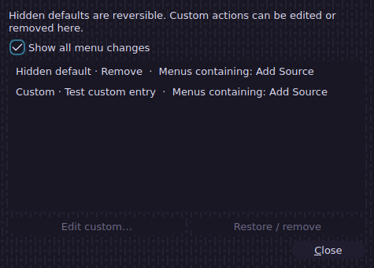 |

**Current scope:** native QMenu actions, scoped hiding, and direct executable
custom entries. The inspector can browse nested native submenus, but custom
entries are appended to the captured menu rather than placed into new nested
groups. Ordering custom commands, selection/source argument placeholders, and
importing external menu-action definitions are not yet implemented. Native
menus containing embedded widget actions are excluded from the default removal
layout for safety.

### Submenu inspection and selected choices

In **Tools → Aftermarket → Workspace → Menus & widgets**, check **List submenu
items** to expand a captured menu into a browsable tree. It includes
currently available nested actions, checked states, disabled rows,
separators, and OBS's color-preset buttons. Leave it unchecked for the
original concise top-level list. Selecting a nested action retains that
action's own submenu scope when inspecting or saving supported rules.

Enable **Show selected submenu choices** to paint the one explicitly
selected choice in a **right-aligned trailing column**, using the current
theme's link/accent color and parentheses, for example:

- **Scale Filtering** — *(Lanczos)* aligned near the submenu arrow
- **Blending Mode** — *(Normal)* aligned at the same right edge
- **Set Color** — *(Red)* (also supports OBS's eight selected preset swatches)

The toggle is off by default and persists as the root-level
`"showSubmenuSelections": true` option in `rules.json`. The main
QAction labels are **never rewritten** to display values. A transparent
drawing layer adds the current choice independently; native arrows and hit
targets stay functional, and the layer disappears when the menu closes.
Long values are elided as space requires. If a submenu exposes no
unambiguous checked choice, the parent remains unchanged. Dynamically populated submenus
may need to be opened before capturing their full list.

| Selected choices in OBS | Expanded inspector menu tree |
| --- | --- |
| 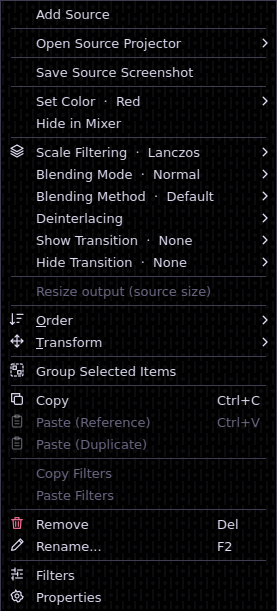 | 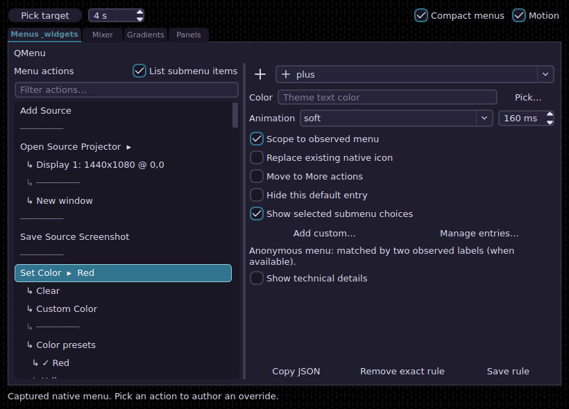 |

### Live rules

The file is re-read just before a menu opens. Close and reopen the menu after editing it; there is no OBS restart or theme replacement. Invalid or partially written JSON keeps the last valid rules.

Example of a complete replacement rules file:

```json
{
  "enabled": true,
  "inspect": false,
  "rules": [
    {"text": "Add Source", "icon": "plus", "color": "#90d4a6"},
    {"text": "Filters", "icon": "sliders", "color": "#9cc4f5"},
    {"objectName": "actionRemoveSource", "icon": "trash", "color": "#f08b8b", "replaceExisting": true}
  ]
}
```

- `text`: exact action label, ignoring mnemonic ampersands, trailing ellipses, case, and shortcut suffixes.
- `objectName`: exact Qt action identifier. Prefer it when available; many OBS menu actions are created without one.
- `menuObjectName`: optional exact menu identifier. If both action selectors are provided, both must match. First matching rule wins.
- `menuContains`: optional array of neighboring action labels that must all be visible in the target menu. Used to scope otherwise anonymous popups. Matches normalized labels, not order. This is a contextual heuristic, not a unique persistent menu ID; it may not match after menu layout or language changes.
- `icon`: one of plus, pencil, trash, copy, clipboard, move, order, group, sliders, gear, pointer, monitor, camera, palette, layers, arrow-in, arrow-out, resize.
- `color`: optional literal color; without it the icon uses the menu text palette. Disabled entries are dimmed.
- `replaceExisting`: opt in to covering a pre-existing icon with an invisible slot and our own drawing, then restoring it on close. The stock Remove rule uses this to give destructive actions their own color.
- `inspect`: logs the discovered menu labels and action object names to the ordinary OBS log; turn it off again afterward. `enabled:false` disables painting but inspection can remain enabled.

## Appearance and motion

### Theme-aware typography and selected states

Aftermarket's own controls use a restrained visual hierarchy without
changing the current OBS theme's font family or color palette. The Inspector
uses normal-weight body text and semibold section headings; Studio Mode
labels scale relative to the active font rather than forcing 12px.
Aftermarket-owned selected Studio view buttons and patchbay track switches
use a fine theme-color outline rather than the stronger generic checked
state. Audio cables, selected source borders and drag previews are also
thinner, while their source/track routes remain unchanged.

Compact menus honor the active font's actual line height. **Native OBS
widgets, menus and source list selection remain owned by OBS and its theme.**

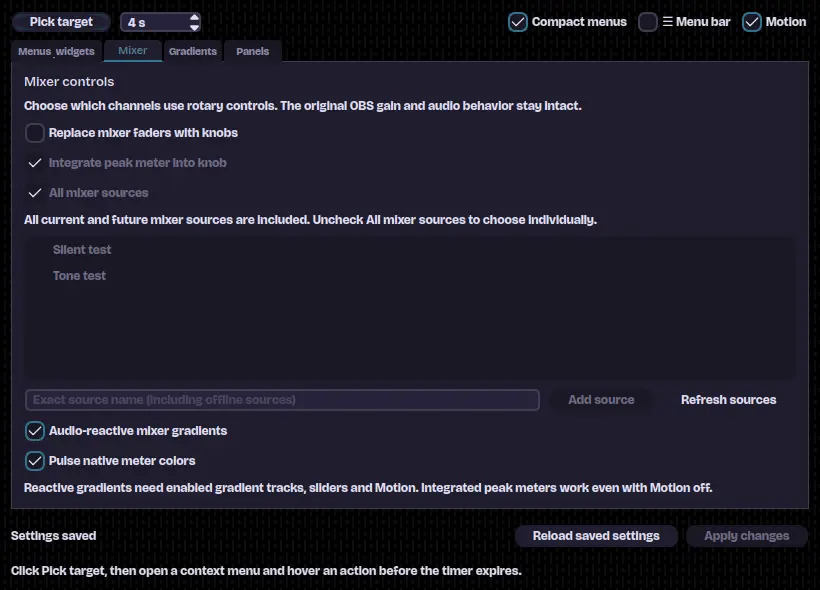

### Theme-aware transform selection

OBS's native selection frame normally uses red borders with square resize
handles. Aftermarket now offers **Modern transform frame and handles** in
**Tools → Aftermarket → Workspace → Gradients → Preview selection**.
This option is **off by default**, applies immediately, and is independent
of gradient tracks and the Motion toggle.

- Uses the active Qt/Colorway theme's link/accent color for **native selection
  borders**, highlight for crop, and a brighter accent for hover. This uses
  OBS's own accessibility color override rather than coloring rendered video.
- Draws a thin, contrast-backed frame with **rounded corner handles** and
  smaller circular edge handles. Hover gives a stronger fill. It follows live
  source transforms, including ordinary resize and rotation.
- The decoration is a **transparent mouse-through companion window**, not
  another scene renderer and not a replacement for OBS transform events.
  Original native handles still receive every click and drag.
- **Scope:** OBS 32.2.0 on composited Linux/X11 was tested. The rounded
  overlay is deliberately hidden at custom zoom/pan levels when its
  approximate projection cannot be trusted, or when the OBS window is not
  active. OBS's native selection remains usable. Group transforms and
  other platforms need separate validation.

<details><summary>Important behavior and limitations</summary>

The visible handles are larger, but **OBS's actual mouse hit targets are not
enlarged**. Enlarging them would require changing OBS native selection
hit-testing and is not part of this visual pass. Custom zoom and grouped
sources retain native handles rather than showing misplaced decorations.

The option persists as root-level `"modernTransformFrame": true` in
`rules.json`. While active, the plugin keeps a snapshot of the previous
OBS accessibility colors and restores them when disabled or unloaded,
preserving external edits rather than overwriting them. Existing user
settings are not changed by installation.

</details>

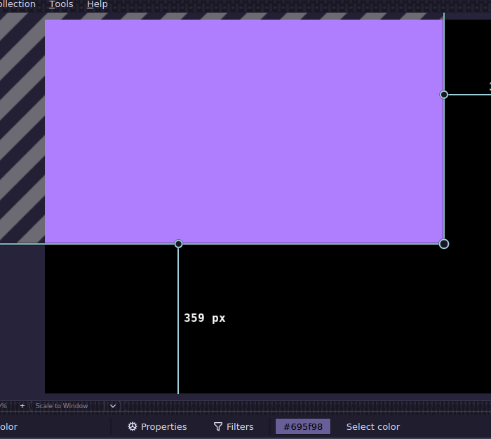

### Motion

Enable **Motion** in **OBS → Settings → Aftermarket → Menus** or from
**Tools → Aftermarket → Workspace**. The same global control governs menu artwork,
dock collapse/expand, AudioBus page switching, and existing reactive gradients.
Motion is off by default, preserving the native immediate behavior until enabled.
For individual menu artwork rules, pick a preset and duration in the inspector.

- **soft**: fade/slide entrance, modest icon growth on hover.
- **pop**: fade/slide with a more pronounced scale transition.
- **spin**: fade/slide with rotation on hover.
- **none**: static icon even when global motion is enabled.

The duration is 60–600 ms (default 160 ms); a capped 9 ms stagger separates successive entrances.
Uncheck Motion for reduced motion. The master switch persists in the rules file;
new UI transitions follow its latest value immediately.

**Native dock collapsing and page switching:** When Motion is enabled, using
a dock's **⋮ → Collapse / Expand** (or middle-clicking its native title) eases
the real QDockWidget height over **165 ms**, with its original min/max size
constraints restored after expansion. Tabbed, floating and custom-title
docks remain governed by the existing native restrictions. Switching between
**Audio Mixer and AudioBus** uses a restrained **210 ms horizontal flip**:
two temporary snapshots turn around the middle of the existing dock, while
the original OBS mixer and routing widgets stay in place. Nothing is rotated
or assigned a graphics effect on the live native controls, and no extra
animation is layered on top. Rapid reversals discard the earlier frame,
and emergency recovery removes the animation. Both dock movements and
page switching are instantaneous with Motion off.

These are **OBS interface animations**, not OBS's video scene-transition
effects. Aftermarket never invokes or replaces a streaming transition.

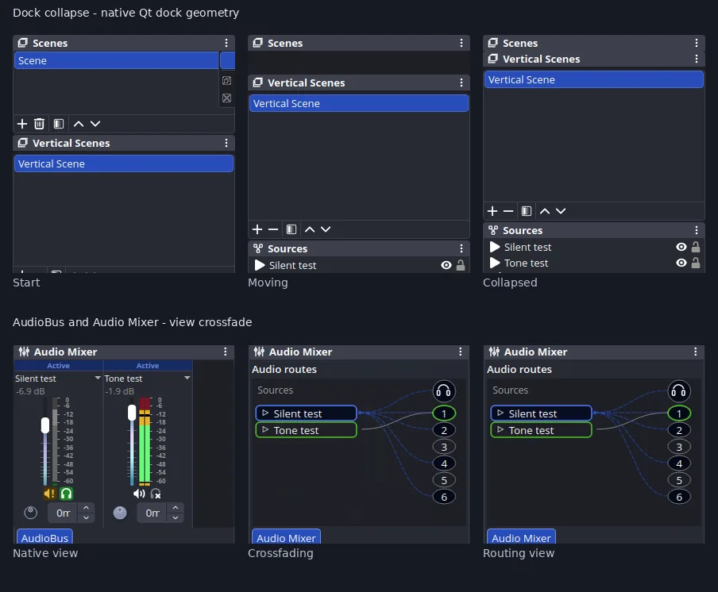

```json
{
  "enabled": true,
  "motion": true,
  "rules": [
    {
      "text": "Filters",
      "icon": "sliders",
      "animation": {"preset": "spin", "duration": 220}
    }
  ]
}
```

Icon motion does not move the native menu hit targets. Only the independently drawn icon layer
changes. The renderer caches rasterized SVGs at the display's device pixel ratio, clips
motion to the icon gutter, uses monotonic elapsed time with cubic easing, and stops its
16 ms timer when transitions finish or the menu closes. Hover retargets from its current
value rather than snapping to an endpoint.

[Real OBS icon reveal frames](screenshots/motion-frames.png).

Verified in isolated OBS 32.2.0 with the actual Colorway Rosé Pine theme: GUI enabled
motion, selected spin and a 600 ms duration for Scale Filtering, persisted the scoped
rule, and captured changing icon pixels during both entrance and hover.

## Safety and implementation

### Emergency recovery mode

**Ctrl+Alt+Shift+F12**, while OBS is focused, immediately activates
**Aftermarket safe mode**. This shortcut is captured even when an Aftermarket
popup has keyboard focus. A second path is always available under
**Tools → Aftermarket → Emergency restore** (including inside the hamburger).
Recovery disables Aftermarket's menu decorations, hamburger, gradient/rotary
effects, audio meter tinting, source/scene row colors, collapsible property
groups, dock backsides, and dock/preview layout enhancements. Original OBS
widgets and actions are restored **without changing scenes, routing or
Aftermarket preferences**. It is not OBS's own *Reset UI* command and does
not reset OBS dock layouts or close the application.

Before changing the UI, recovery writes a separate
`plugin_config/aftermarket/safe-mode.flag` alongside `rules.json`.
On the next OBS startup, the plugin checks this marker and does not apply
customizations, **even if** the settings file is unreadable. Repeated use of
the emergency shortcut cannot accidentally re-enable a broken interface.
After the issue is corrected, choose **Tools → Aftermarket → Resume UI
customizations**. Only successful explicit resume removes the marker; the
original `rules.json` is never rewritten by emergency mode.

If OBS is unable to reach the shortcut because startup fails, create
`safe-mode.flag` in the same plugin configuration folder as `rules.json`
while OBS is closed, then reopen OBS. Remove it or use **Resume** only
when ready to try the customizations again.

The shortcut works within OBS/Qt, not as a system-wide hotkey when another
application is focused. Desktop environments may intercept key combinations;
the Tools action and on-disk marker are alternatives.

### Why this isn't another QSS theme

A global, non-consuming event filter discovers QMenus as they are polished or shown.
Before each popup, matched, ordinary actions receive a transparent icon as a temporary
layout reservation. The actual icon artwork is owned by a mouse-transparent child
widget, painted against the menu's real action geometry. It does not become a native
QAction icon. OBS/Qt still control keyboard navigation, shortcuts, selection, submenus,
and action execution.

On close or unload, original icons and visibility are restored if the reservation
still belongs to us. Existing icons are left alone by default. Separators,
checkable actions and QWidgetActions are not decorated. Unknown actions are untouched.
The extension is local to UI rendering, not the OBS video compositor.

Rules remain declarative JSON; they are not evaluated as scripts. Explicit
`menuCustom` actions are an exception to the original visual-only scope: when
clicked, they launch the configured executable and argument array directly,
without invoking a shell automatically. Only add trusted commands. Aftermarket
does not implement a complete custom menu renderer, custom icon file imports,
general-purpose widget styling, or runtime scripting.

### Verification

- Qt regression test: actual magenta pixels in an offscreen QMenu grab; native icon pixels are transparent; existing and checkable icons preserved; rule hot reload, disabled state, invalid JSON fallback, explicit icon override and restoration, cleanup on unload.
- OBS 32.2.0 isolated Xvfb profile: 22 source context-menu actions augmented, then disabled and re-enabled without restarting OBS. The menu comparison in the [README](../README.md#menus) was recaptured from the actual enabled and disabled popup in a later isolated session.
- Clicked rendered Rename item in the real popup and verified native inline editing. See [native rename receipt](screenshots/native-rename.png).
- Isolated OBS exited via Ctrl+Q. No crash observed. The OBS log reported 3 memory leaks at shutdown; their ownership was not established. No claim of leak-free operation.

Inspector slice verification (same isolated OBS configuration):
- Captured an actual source widget and displayed its ancestry.
- Captured Sources context menu from pointer position, selected Scale Filtering, saved a scoped color override from the GUI, reopened the menu and programmatically counted 12 magenta pixels in the actual popup.
- Removed that exact override from the GUI and confirmed the original broader rule remained.
- Added regression tests for scoped matching, escaped ampersands, snapshot lifetime, preserving unknown root fields and unrelated rules, refusing invalid JSON, duplicate override replacement, real rendered pixels, and GUI rule saves.

Real OBS testing is limited to Linux/X11 with OBS 32.2.0 and Qt 6.4.2, using native themes and Colorway.
Additional themes, DPI scaling, RTL, other platforms and unsupported native widgets need validation. See the [verification history](../ACTIVE_WORK.md) for individual runtime receipts and known limitations.

Recent real OBS checks include the split compact source picker, single-click creation, existing-source filtering and addition, and two-monitor filter submenu anchoring. The regression suite also covers native dock snapshots, Quick Find and the Action Strip. Recent verification used 29/30 offscreen CTests plus a passing single-head XCB run of the display-sensitive panels test.

### Disable/remove

Use **Tools → Aftermarket → Emergency restore** for reversible suspension of the plugin UI. Setting `"enabled": false` in rules.json disables rule-driven augmentation; it is not a complete plugin unload. To completely unload,
close OBS and remove just `plugins/aftermarket/bin/64bit/aftermarket.so`
from its user config directory. The rules file can be preserved.
